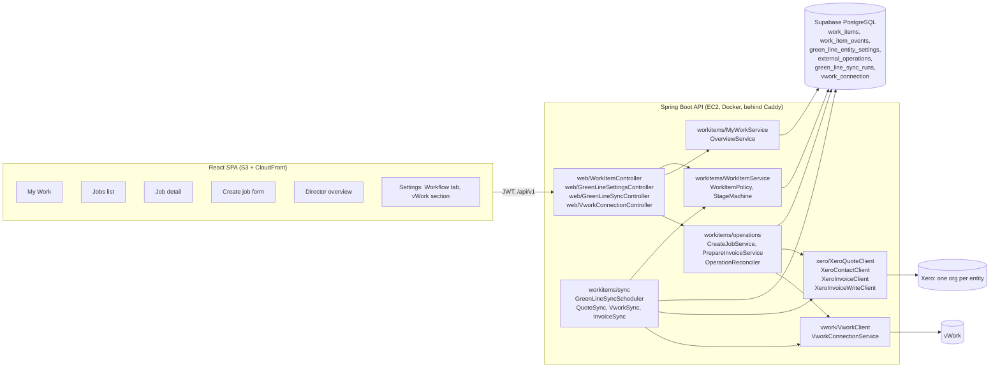
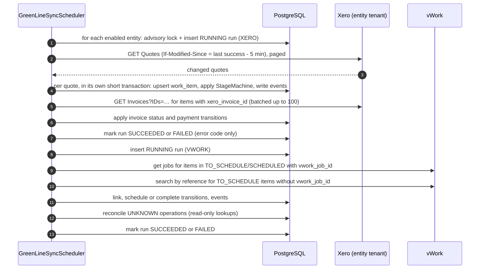
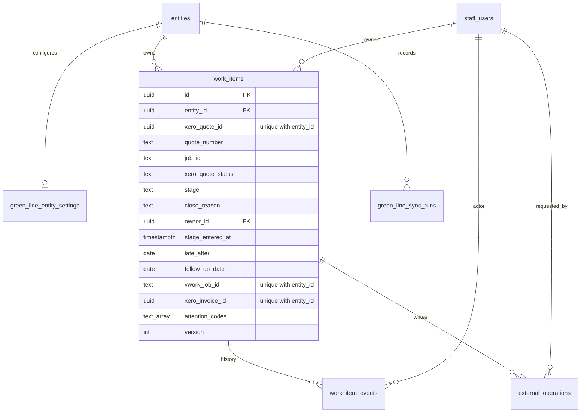
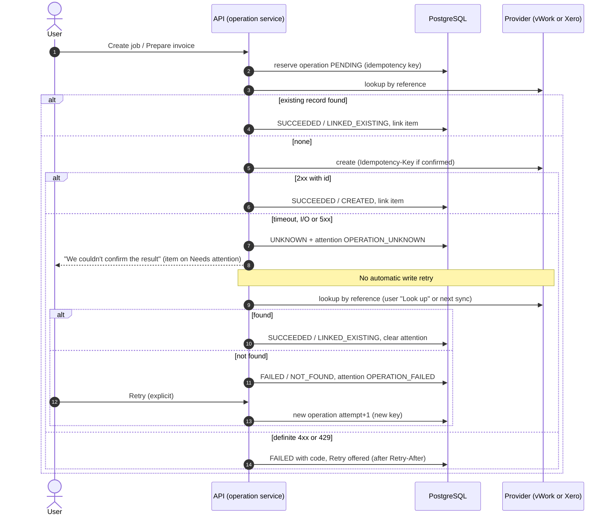
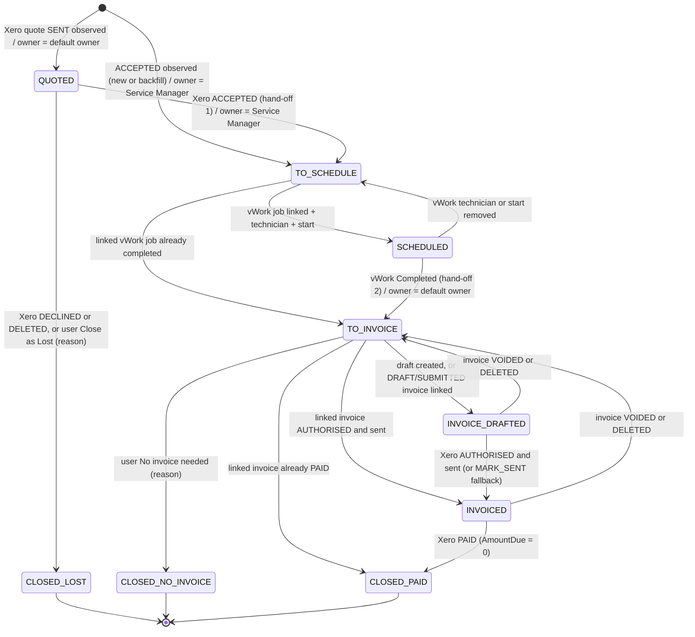
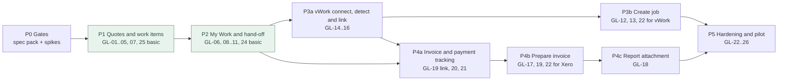

# Quote-to-invoice green line: technical implementation plan

- Status: draft for human review. This is not a spec pack (see §14 and task GL-T01).
- Prepared: 19 November 2026 (Pacific/Auckland).
- Source: Notion page "Air Concepts green line for quote to invoice" (`41c5eb94886481e7a8fbcef7cbc35271`, last edited 18 Nov 2026 21:13 UTC). The human authorised reading it directly for this planning task.
- Requirement IDs: GL-01 to GL-26 come from the Notion page. Task IDs use `GL-T<nn>`.
- Human instruction recorded on 19 Nov 2026: **the vWork API key is set by the Director in the frontend.** It is not taken from Parameter Store.
- Human decisions recorded on 19 Nov 2026. These resolve the blocking questions Q1 to Q4 in §14.3:
  - **D1 (Q1):** keep entity access as it is. Every active staff user sees every enabled entity, so there is no per-user entity restriction.
  - **D2 (Q2):** confirmed. Where the green line differs from Use Case 1 (30 Oct), the green line supersedes it.
  - **D3 (Q3):** **one vWork account serves all entities.** There is a single, organisation-wide vWork connection.
  - **D4 (Q4):** **manual reassignment is deferred.** Owners change only at the automatic moments: creation, acceptance and completion. Owner editing (part of GL-04) and the reassign part of GL-08 are deferred.
  - **D5 (Q13):** **the vWork template identifies the entity.** Each vWork template belongs to exactly one entity. A job's template tells the dashboard which entity the job belongs to.

> **How to use this plan.** Implement one phase at a time, in order, and one task per branch and session (AGENTS.md §1). Before writing code for any task, check its gates in §11. Every task that touches Xero, vWork, auth, migrations or entity isolation still needs its own small plan approved (AGENTS.md §1 and §5). Phase P0 must finish first.

---

## 1. Executive Summary

The green line turns one **Xero quote** into one **dashboard work item**. The item carries a single Job ID (the quote Reference) from the moment the quote is Sent until its invoice is fully paid.
- The dashboard does not replace Xero or vWork. It **mirrors** their state, **coordinates** two hand-offs and **performs exactly four external writes**, each started by a person:
  1. Create a vWork job from an accepted quote (no prices).
  2. Create a **draft** ACCREC invoice in the item's own Xero organisation.
  3. Attach the vWork report PDF to that draft.
  4. Mark a **sent** quote as **accepted** in its own Xero organisation (GL-27, approved 23 November 2026). Confirmation step, one reserved operation, no second write after an unknown outcome.
- Everything else is read: quote status, contact details, schedule, completion, invoice status and payment.
- Each user's home screen becomes **My Work**. It shows what that user must do next across every entity they can see.
- The Director gets an **oversight view**.
- Settings gain per-entity workflow defaults and a Director-managed **vWork connection**.

**Recommended approach.** Extend the existing modular monolith:
- Backend: add the `workitems` and `vwork` packages, extend `xero`, use JDBC repositories, and add forward-only Supabase migrations.
- Frontend: add new pages to the existing route union and reuse `useResource`/`useAction`, `Modal`, `Feedback` and the financial table patterns.

There are no new frameworks, no router, no message broker and no ShedLock. Background work is scheduled polling on the single EC2 host, protected by PostgreSQL advisory locks. This copies `ForecastSyncScheduler`.

**Smallest practical MVP (phases P1 and P2).** This covers the Xero quote mirror, work items, Job ID flags, owner, follow-up and notes, the acceptance hand-off to the entity's Service Manager, My Work, late flags and a basic Director view.
- It needs **no external writes** and only one spike (Xero quote and contact read).
- Staff gain a single list of every open quote and every accepted job waiting for a vWork job.

**Gates before any code.** These are set by AGENTS.md and cannot be waived by this plan:
1. A human-approved spec pack, `docs/specs/GL.md`.
2. Spike notes that confirm each Xero and vWork capability used.
3. Human approval of each sensitive task's small plan.
4. Human review of each migration and OpenAPI change.

---

## 2. Existing Application Assessment

All facts below were confirmed by reading the repository on 19 November 2026.

### 2.1 Architecture and conventions

| Area | What exists | Reuse for the green line |
|---|---|---|
| Backend stack | Spring Boot 4.1.2, Java 25, `spring-boot-starter-webmvc`, `starter-jdbc`, springdoc 3.2, Jackson 3 (`tools.jackson.*`). The Maven Enforcer **bans JPA, Hibernate, Flyway and Liquibase** | Same stack, with plain `JdbcTemplate` repositories |
| Package layout | `com.airconcepts.dashboard.{web, invoices, entities, staff, forecast, forecast.sync, xero, security, config, time}`. All controllers are in `web/` | Add `workitems`, `workitems.sync`, `workitems.operations`, `vwork`. Put controllers in `web/` |
| DTOs | Records grouped in `final class XxxViews` with `@Schema(name, requiredProperties)`. Money is a `BigDecimal` serialised as a string decimal (`@JsonFormat(shape=STRING)`). Request records sit inside the controller with Jakarta validation | `WorkItemViews`, `GreenLineSettingsViews`, `VworkConnectionViews` |
| Errors | `web/ApiFailure(HttpStatus, code, safeDetail)` and `ProviderFailure` (502, with `upstreamStatus` and `retryAfterSeconds`) are mapped to ProblemDetail with a `code` by `ApiFailureHandler`. `DataIntegrityViolationException` becomes 409 `RECORD_CONFLICT` | Add new stable codes (§6.6) |
| Controllers | `@SecurityRequirement(name="bearerAuth")`, `@AuthenticationPrincipal Jwt`, `users.from(jwt)` → `CurrentUser`, `@Operation(operationId=…)` on every method, `CacheControl.noStore()` on every response | Copy `web/InvoiceController` exactly |
| Persistence and concurrency | `JdbcTemplate` with positional `?`, text-block SQL and `RowMapper` constants. Locking uses `pg_advisory_xact_lock` keys (150016 staff/assignment, 150003 Xero mapping) and `hashtextextended('forecast-sync:'+entity)` | Use the same advisory-lock pattern for green-line sync and operations |
| Time | `time/BusinessTime` (Pacific/Auckland) and a `Clock` bean (`XeroConfig.dashboardClock`) | Inject `Clock`. Add `time/WorkingDays` |
| Scheduling | `config/SchedulingConfig` has `@EnableScheduling`. `forecast/sync/ForecastSyncScheduler` uses a cron in the Auckland zone and is gated by `@ConditionalOnProperty`. `ForecastDocumentRepository.begin` prevents overlap with an advisory lock plus a RUNNING row younger than 30 minutes | Copy this for `GreenLineSyncScheduler` |
| Hosting | One EC2 host (ARM64) running Docker Compose: the API container plus Caddy on ports 80/443. "Single-host replacement causes downtime." Secrets come from Parameter Store `/air-concepts/<env>/` | A single scheduler instance is safe. A future webhook can be routed through Caddy |

### 2.2 Authentication, roles and entities

- **JWT:** `security/JwtDecoderConfig` checks the Supabase JWKS (ES256 and RS256), the issuer and the audience. `security/SecurityConfig` is stateless and requires `authenticated()` by default. Forecast paths add a URL role check.
- **Roles:**
  - `enum Role { DIRECTOR, FINANCIAL_ADMIN, STANDARD_USER }`. The role is read from `public.staff_users` (active only) **on every request** by `JdbcRoleLookup`. It is never read from JWT claims.
  - Services call `user.requireRole(...)`.
  - Writes re-check the actor inside the transaction (example: `InvoiceAssignmentRepository.assign`).
- **There is no Service Manager role and no designation concept.**
- **Entity access:** every active staff user sees every non-archived entity (FR-UC15-12). There is no per-user entity membership table.
  - `EntityService.get(user, entityId)` returns 404 when an entity is missing or archived.
  - `XeroConnectionService.authorisedAccess(user, entityId)` returns `TenantAccess(entityId, tenantId, grantId, accessToken)` with the tenant **always resolved server-side**.
  - `systemAccess(entity)` is only for scheduled work.

### 2.3 Xero integration

- **OAuth:** `xero/XeroConnectionService`, `XeroOAuthClient`, `XeroSettings`. Only the Director can connect, reconnect or remap. OAuth state is hashed and single-use.
- **Scopes today:** `offline_access accounting.invoices.read accounting.attachments.read`. **This is read-only, and quotes and contacts are not requested.**
- **Tokens:**
  - Encrypted with AES-256-GCM by `xero/TokenCipher`, using a versioned envelope and AAD `grantId:purpose`. The key comes from `XERO_TOKEN_ENCRYPTION_KEY`.
  - Refreshed under a row lock in `XeroGrantService.access`.
  - Stored in `xero_grants` and `xero_entity_connections`.
- **Clients:** one shared `RestClient xeroAccountingRestClient`, with a 5 s connect and 20 s read timeout and no redirects.
  - Clients: `XeroInvoiceClient` (list and detail), `XeroAttachmentClient` (list and file, 25 MiB cap) and `XeroForecastClient` (paged reads with `If-Modified-Since`, and rate-limit headers captured).
  - Errors are mapped by `XeroReadErrors`: 401 → `XERO_RECONNECT_REQUIRED`, 403 → `XERO_ORGANISATION_ACCESS_DENIED`, 429 → `XERO_RATE_LIMITED`, 404 → `XERO_DOCUMENT_UNAVAILABLE`, I/O failure → `XERO_UNAVAILABLE`.
  - `XeroReadHealth` keeps per-mapping 429 and auth state.
  - `ForecastRequestPacer` keeps requests at least 1.25 s apart per tenant, but only for forecast calls.
- **No Xero write exists.** `docs/spikes/uc4-xero-expected-date-writeback.md` notes, from the docs only, that `Idempotency-Key` is accepted on invoice writes. This is partial and unverified.
- **Not yet read:** quotes and contacts.

### 2.4 vWork

- **There is no vWork code.**
- `docs/configuration.md` and `docs/security-access.md` list a placeholder Parameter Store SecureString, `backend/vwork/api-key`, that nothing reads. **This plan retires it**: the Director enters the key in the frontend (§8.3).
- `docs/spikes/README.md` has the open spike "vWork API for hours per worker, completion photos and webhooks", which has not started.

### 2.5 Existing features to reuse

| Feature | Location | Reuse |
|---|---|---|
| Sales invoice assignment (dashboard-only metadata keyed by entity and Xero ID) | `invoices/InvoiceAssignmentRepository`, table `invoice_assignments` | The pattern for owner metadata: key by `(entity_id, external_id)` and re-check the actor and target inside the transaction |
| Staff list for pickers | `GET /api/v1/staff` (`listAssignableStaff`, Director and FA) | Owner and Service Manager pickers. Widen read access to all roles for display names (GL-T12) |
| Xero invoice detail and attachments | `XeroInvoiceClient.detail`, `XeroAttachmentClient` | Invoice status and payment reads. Job detail "open invoice" link |
| Forecast audit | `forecast_audit`, `ForecastAssumptionRepository.audit` | **Not reused**: its CHECK constraints are forecast-specific. A new `work_item_events` table follows the same jsonb before/after pattern |
| Sync run history | `forecast_sync_runs`, `ForecastSyncController` | The model for `green_line_sync_runs` and its freshness endpoint |
| Idempotent external call | `staff/StaffProvision` with `StaffRepository.reserve` (reserve a row, call out, complete) | The model for `external_operations` |
| Settings | `frontend/src/settings/Settings.tsx` (tabs: Entities, Users), `EntitySettings.tsx` `EntityCard`, `EntityDialog.tsx` | Add a **Workflow** tab that holds the shared **vWork account** card (D3) and the per-entity workflow cards |

### 2.6 Frontend

- **No router library, no TanStack Query, no MSW, no generated client.** The runtime dependencies are `react`, `react-dom` and `@supabase/supabase-js`.
- **Navigation:** a `useState` union in `frontend/src/workspace/Workspace.tsx` (line 57), `"invoices" | "forecast" | "settings"`.
  - Every role lands on Invoices.
  - Nav buttons use `aria-current`.
  - A `dirty` guard asks before leaving unsaved edits.
  - `lazy()` with `Suspense` is used for heavy pages.
- **Data:**
  - `api/useResource.ts` (reset when the key changes, abort on cleanup, keep data while refreshing).
  - `api/useAction.ts` (one request in flight, never retries automatically).
  - Keys include `subject:role:entityId`.
  - `api/dashboard.ts` `DashboardApi`, `api/client.ts` `ApiClient` (allows only `/api/v1/` paths and carries the `messages` map of error codes), `api/contracts.ts` (types from `api/generated/schema.d.ts` plus runtime guards).
- **Entity context:** `workspace/EntitySelector.tsx` (native select, with an "All entities" option offered only on Forecast). The choice is stored as `uc5.entity.v1:${subject}`.
- **UI building blocks:**
  - `ui/Feedback.tsx`: `Loading`, `Failure` (Retry with a countdown), `Notice`, `roleNames`.
  - `ui/Modal.tsx` (focus trap and inert background).
  - The `financial-table` pattern in `invoices/InvoiceList.tsx` (sortable headers with `aria-sort`, mobile cards below 48rem).
  - `invoices/InvoiceFilters.tsx`, `invoices/AssignmentPicker.tsx` (row-level select with `useAction`), `ol.stepper` in `settings/EntityDialog.tsx`, and `ui/format.ts` (`formatMoney`, `formatDate`, `formatFetchTime`).
- **No toast system:** success uses an inline `Notice`.
- **Tests:**
  - Vitest with React Testing Library and `src/test/api.ts` `testApi(handler)` and `src/test/fixtures.ts`. Test titles include requirement IDs.
  - Playwright (Chromium) in `frontend/e2e`, with `e2e/support/green-lane.ts` `greenLane(page, role)` faking the API.
- **Standard:** `docs/ui-ux-design-specification.md`. The relevant sections are §2 (shell order: Overview, Tasks, Invoices, Service jobs, …), §3 (financial tables), §4 (feedback, review step, no optimistic success), §5 (responsive), §6 (roles and organisations), §7 (WCAG 2.2 AA), §9 (architecture) and §10 (Definition of Done).

### 2.7 Database

- **Migrations:** `supabase/migrations/<yyyymmddhhmmss>_<slug>.sql`. Each starts with `set lock_timeout = '5s';` and is forward-only.
- **Every table:**
  - `enable row level security`
  - `revoke all … from public, anon, authenticated`
  - `grant select, insert, update … to service_role`
  - Audit tables grant only `select, insert`.
- **Relevant tables:** `entities(id, code, display_name, created_at, archived_at)`, `staff_users(id, email, display_name, role, active, …)`, `xero_grants`, `xero_entity_connections`, `invoice_assignments`, `forecast_sync_runs`, `forecast_audit`.
- **Schema tests:** Testcontainers (`Uc5SchemaTest`, `Uc4SchemaTest`) apply every migration to `postgres:17-alpine`. These do not run locally because Docker is not run (AGENTS.md learned rule). They do run in CI.

### 2.8 What must be built

| Capability | Status |
|---|---|
| Read Xero quotes and contacts | New client and new OAuth scopes (re-consent needed) |
| Work items, stage history, settings, operations ledger, sync runs | New tables and services |
| Service Manager designation | New per-entity setting. No new role |
| vWork connection, read, create, report | New package, new table, Director key entry in the UI |
| Xero draft invoice create and attachment upload | New write client, write scopes and idempotency |
| My Work, Jobs list, Job detail, Create job form, Director overview, Workflow settings | New frontend feature folder `src/workitems/` plus settings additions |

---

## 3. Functional Requirements

### 3.1 Roles and responsibilities

| Business role | How it is represented | Responsibilities |
|---|---|---|
| Director | `Role.DIRECTOR` | Oversight. Can do every action. Edits settings and the vWork key |
| Financial Admin ("Weny") | `Role.FINANCIAL_ADMIN`. Set per entity as `default_owner_id` | Owns Quoted, To invoice, Invoice drafted and Invoiced. Prepare invoice, No invoice needed, Close as Lost |
| Service Manager | **Designation**: `green_line_entity_settings.service_manager_id`. Can be any active staff user, usually `STANDARD_USER` | Owns To schedule and Scheduled. Create job for **their designated entity** |
| Other Standard Users | `Role.STANDARD_USER` without a designation | Read-only view |
| Technicians | Not dashboard users | Shown as the vWork assignment |

### 3.2 Functional requirements (normalised from GL-01 to GL-26)

| Group | Requirement summary | IDs |
|---|---|---|
| Quote mirror | List Xero quotes from Sent onwards per enabled entity. Drafts are excluded. Show the entity, quote number, Job ID, customer, Xero status and total | GL-01 |
| Work item identity | Exactly one item per `(entity, Xero quote ID)`, enforced by a database constraint | GL-02 |
| Job ID | Quote Reference = Job ID. A blank, duplicate or mismatched Job ID raises a flag but never blocks | GL-03 |
| Dashboard metadata | Owner (defaults to the entity's default owner), follow-up date and notes. Audit-logged. No write to Xero | GL-04 |
| Lost | Xero Declined → Closed (Lost). A manual Close as Lost needs a reason. Items never close because of elapsed time | GL-05 |
| Entity isolation | Every item, call and write is bound to one entity. Users see only entities they may access. Cross-entity requests are denied | GL-06 |
| Audit | Every stage change and action records the user, time, and previous and new values. Shown on the timeline | GL-07 |
| Hand-off 1 | Accepted → To schedule, owner becomes the entity's Service Manager. Manual reassignment is deferred (D4) | GL-08 |
| Action matrix | Create job: designated SM and Director. Prepare invoice, No invoice needed and Close as Lost: FA and Director. Others view only. Enforced by the backend | GL-09 |
| My Work | Landing screen, cross-entity, with three lists, oldest first, an entity label and filter, and the specified row columns | GL-10 |
| Late flags | Per-entity working-day threshold (default 2) on To invoice and Invoice drafted | GL-11 |
| Create job form | Pre-filled from the quote and the Xero contact, with no prices. Required fields are highlighted and block submission. Template can be changed | GL-12 |
| Create job | Creates one vWork job with the Job ID as reference, stores the job ID and disables the button | GL-13 |
| Duplicate job guard | Search vWork by Job ID before offering Create job. If found, link it. If the search can't run, show a warning and require confirmation | GL-14 |
| Schedule read-back | Technician and start time present → Scheduled | GL-15 |
| Completion | vWork Completed → To invoice, owner becomes the default owner, with completion time and notes. No email involved | GL-16 |
| Prepare invoice | One draft invoice in the item's own tenant, using the quote's lines and prices, with Reference "Job ID / quote number". Stores the invoice ID and disables the button | GL-17 |
| Report | Attach the vWork report when it can be retrieved. Otherwise flag "Report not attached" until confirmed | GL-18 |
| Duplicate invoice guard | Search Xero for an invoice with the Job ID or quote number first. If found, link it | GL-19 |
| No invoice needed | Close with a required reason | GL-20 |
| Invoice and payment | Approved and sent → Invoiced. Fully paid → Closed (Paid). Partly paid stays Invoiced, showing the balance | GL-21 |
| Unknown outcomes | A failed or unknown write → Needs attention. Look up first, link if found, offer Retry only when nothing exists. Never retry silently | GL-22 |
| Go-live backfill | Quotes accepted in the last 90 days that aren't invoiced. Take the real state from vWork | GL-23 |
| Director overview | Counts by stage per entity, the oldest item in To invoice and Invoice drafted, and the completed-not-invoiced list | GL-24 |
| Sync freshness | Per entity and system: last successful sync, manual refresh, and failures shown immediately | GL-25 |
| Data safety | No prices in vWork payloads. Tokens and keys never reach the browser, logs or git | GL-26 |
| Accept in Xero (added 23 November 2026, approved) | Finance or a Director marks a Sent quote as Accepted in Xero from the job, after a confirmation step. Xero is updated first through `external_operations`; on success the item moves Quoted → To schedule with the Service Manager as owner, exactly as the sync hand-off does. A rejected or unknown outcome is recorded, never retried silently. The live Xero write is disabled (`quote-accept-mode: disabled`) until a demo-organisation check confirms the endpoint, scope and idempotency behaviour | GL-27 |

### 3.3 Business rules

1. **Keys:** the internal key is `(entity_id, xero_quote_id)`. The business key is the Job ID, which is the quote `Reference` trimmed, with case kept for display and compared case-insensitively.
2. **Ownership** changes automatically at exactly two moments: acceptance (default owner → Service Manager) and completion (→ default owner). Manual reassignment is deferred (D4).
3. **Scope:** one quote → one vWork job → one full-amount invoice. Staged billing, deposits and multi-job quotes are out of scope (§14.4).
4. **Prices never leave for vWork.** The Create job payload type has no money fields (enforced at compile time and by a test).
5. **Elapsed time never closes an item.**
6. **Late:** stage ∈ {TO_INVOICE, INVOICE_DRAFTED} and the number of working days since entering the stage is greater than the entity threshold.
7. **Partial payment** keeps the item in INVOICED.
8. **Write rule:** the dashboard writes to a Xero quote only to mark it Accepted, from the job, with confirmation (GL-27). It never changes a Xero invoice's status and never sends an invoice. The FA approves and sends in Xero.

### 3.4 Unclear or missing decisions

These are listed in §14 with a working assumption for each. The blocking ones (Q1 to Q4) were answered on 19 Nov 2026 as decisions D1 to D4 (see the header).

---

## 4. Proposed Solution Architecture

### 4.1 Component view



### 4.2 System-of-record ownership

| Data | Owner | Dashboard role |
|---|---|---|
| Quote content, status, acceptance, lines, prices | Xero | Read-only mirror (cached summary columns). Lines are read live when needed |
| Customer contact, address, phone | Xero | Read live for the Create job form. Not stored beyond the item's customer name |
| Owner, follow-up date, notes, stage, stage history, closing reason, flags | **Dashboard** | Authoritative |
| vWork job, schedule, technician, completion, notes, report | vWork | Read-only mirror of summary fields. Only the job is created by the dashboard |
| Invoice content, status, sending, payments | Xero | The draft is created by the dashboard. Everything after that is read-only |
| Links between quote, job and invoice | **Dashboard** | Authoritative (`work_items`) |
| vWork API key | **Dashboard** (encrypted) | Entered by the Director, never returned |
| Xero tokens | **Dashboard** (encrypted, existing) | Unchanged |

### 4.3 Data flow: scheduled sync



### 4.4 Architectural decisions

| # | Decision | Reason |
|---|---|---|
| AD-1 | Polling every 10 minutes during business hours (07:00–19:00 Auckland, Monday to Friday) and hourly otherwise. Cron and interval are configurable (`dashboard.green-line.sync.*`) | Webhooks are unverified (vWork) or not planned (Xero). One host means polling is simple and reliable. The volume is well inside Xero limits (§8.1.5) |
| AD-2 | Webhook payloads are never trusted. A future vWork webhook only **triggers a re-read** of the job (GL-T35) | Avoids spoofing and ordering bugs |
| AD-3 | Every external write goes through `external_operations`, with an idempotency key persisted before the call | AGENTS.md §7 and the `external-integration` checklist |
| AD-4 | The Service Manager is a per-entity designation, not a role | Keeps the role enum and auth hook unchanged. Matches "the entity's designated Service Manager" in GL-09 |
| AD-5 | Allowed actions are computed **server-side** and returned with each item (`allowedActions`). The UI only renders them | UI/UX spec §6: never infer permissions from role names. One source of truth |
| AD-6 | No React Router and no TanStack Query. Extend the `Workspace` route union | Avoids an unapproved dependency or architecture change (UI/UX spec §9, AGENTS.md §14) |
| AD-7 | Cache only summary fields from Xero and vWork. Read quote lines and contacts live when needed | Minimises stale financial data. Xero stays the source of truth |
| AD-8 | Roll out per entity with `green_line_entity_settings.enabled` (Services first, then HotAS) | Generic N-organisation support. Matches the pilot in Notion I5 |

---

## 5. Frontend Technical Design

### 5.1 Navigation and routing

Change `frontend/src/workspace/Workspace.tsx`:

```ts
type Route = "overview" | "mywork" | "invoices" | "jobs" | "forecast" | "settings";
// Landing: "mywork" for every role (GL-10). Keep the existing xeroAttempt exception → "settings" for Director.
```

- **Nav order** follows UI/UX spec §2 "Application shell":
  - **Overview** (Director only; the Director overview) in the *Overview* slot
  - **My Work** in the *Tasks* slot
  - **Invoices**
  - **Jobs** (the Quotes and work-items list) in the *Service jobs* slot
  - **Forecast**
  - **Settings**

  The labels "My Work" and "Jobs" need confirming (Q6).
- **Route guard:** `overview` falls back to `mywork` for anyone who isn't a Director. This extends the existing `currentRoute` guard.
- **Job detail is not a separate route.** Both My Work and Jobs use the list and detail layout: the existing `.invoice-layout.has-detail` CSS, generalised to `.list-detail-layout` in `ui/styles.css`. Each page keeps `selected: {entityId, itemId} | null`.
  - "Back" restores the filters, selection, scroll position and focus, as in `Invoices.tsx`.
  - There is no deep link. This matches the app today, which has no URLs. Deep links are deferred until a router is approved.
- **Entity context on My Work and Jobs:**
  - The context-bar `EntitySelector` offers **All entities** (default) plus each entity.
  - The choice filters the list through `entityId`.
  - Every row shows an entity badge (UI/UX spec §1: the entity name is always shown and kept separate from status colour).
- **Acting from "All entities" (UI/UX spec §2: "All entities" is view-only):** row and detail actions always run against the item's own entity. The job detail header shows that entity prominently, and every consequential action dialog repeats the entity name. This counts as "opening a specific entity before acting". It is recorded as an interpretation for spec-pack approval (Q7).

### 5.2 Feature folder `frontend/src/workitems/`

| File | Responsibility |
|---|---|
| `contracts.ts` | Type aliases from `api/generated/schema.d.ts` (`WorkItemSummary`, `WorkItemDetail`, `MyWork`, `Overview`, `CreateJobDraft`, `OperationView`, `GreenLineSettings`, `SyncStatus`, `VworkConnection`) plus runtime guards (`isWorkItemSummary`, …), following `api/contracts.ts` |
| `stageText.ts` | Display text: stage labels, next-action verbs, close reasons, flag and attention labels (NZ English) |
| `MyWork.tsx` | Three sections (`<section aria-labelledby>`), each holding a `WorkItemTable`. A polite status line with counts. Refresh button. Freshness strip |
| `WorkItemTable.tsx` | Shared table and mobile cards. Columns: Job ID, customer, entity badge, stage badge, next action (verb button or text), days in stage, late badge. Copies `InvoiceList` markup, `aria-sort` and the 48rem card switch |
| `JobsList.tsx` | The Quotes screen: server-side filters (entity via the context selector, stage, Xero status, owner, follow-up due before, search by Job ID/quote number/customer, late only), sort, pagination (copy the `.pagination` block in `Invoices.tsx`), inline edits |
| `InlineFollowUp.tsx` | Row-level date input with save and cancel, `aria-invalid` and `aria-describedby` on error |
| `JobDetail.tsx` | Header: Job ID, quote number, customer, entity badge, stage badge, flags. Primary action button. Secondary actions. Links panel. vWork panel. Invoice panel. Notes and follow-up form. Timeline |
| `StageTimeline.tsx` | `ol` of events (newest first): who, when (`formatFetchTime`), from → to, detail. Copies `forecast/History.tsx` card styles |
| `StageProgress.tsx` | Compact stepper of the seven stages, using `ol.stepper` from `EntityDialog.tsx` with `aria-current="step"` |
| `ReasonDialog.tsx` | `Modal` for Close as Lost and No invoice needed. The reason is required (1–500 characters) and the dialog shows the entity, Job ID and quote number. Errors focus the field |
| `CreateJobForm.tsx` | Full-width form panel (§5.4) |
| `PrepareInvoiceDialog.tsx` | Review step: entity, Xero organisation name, contact, line count, total (`formatMoney`), Reference to be used, and existing-invoice search result |
| `OperationAttention.tsx` | For an item with an UNKNOWN or FAILED operation: explanation, **Look up** button, and **Retry** only when the server returns `RETRY` in `allowedActions` (GL-22) |
| `SyncFreshness.tsx` | Per-entity strip: "Xero synced 10:42 · vWork synced 10:43". Failure in error tone with the last good time. Refresh button (GL-25) |
| `DirectorOverview.tsx` | Per-entity stage count tiles, the oldest To invoice and Invoice drafted items, and the completed-not-invoiced table sorted by days waiting (GL-24) |
| `*.test.tsx` | One test file per component (§13) |

Settings additions in `frontend/src/settings/`:
- `WorkflowSettings.tsx`: a new **Workflow** tab next to Entities and Users. Each enabled or available entity gets a card with: Enabled toggle, default owner (select of active FA and Director), Service Manager (select of active staff), **vWork templates** (from P3a: the templates that belong to this entity, with exactly one marked as default; chosen from `GET /vwork/templates` when listing is supported, otherwise typed in; a template already assigned to another entity is rejected, D5), late threshold (1–30 working days) and backfill window (0–365 days). Save with a review step (`window.confirm` pattern from `UserSettings`).
- `VworkConnectionSection.tsx` is a single **vWork account** card at the top of the Workflow tab. There is one vWork account for all entities (D3). It shows:
  - Status badge (Not connected, Verified, Not verified, Key rejected), configured by and when, last verified.
  - Actions: **Connect vWork** or **Replace key**, both opening a `Modal` with a `type="password"` input (`autocomplete="off"`, never pre-filled or echoed), and **Disconnect** with a confirmation.

  The field is cleared from component state as soon as the request ends, whether it succeeds or fails.

### 5.3 API adapter changes

- **`frontend/src/api/dashboard.ts`:** add methods such as `myWork(entityId?, signal)`, `workItems(query, signal)`, `workItem(entityId, itemId, signal)`, `updateWorkItem(entityId, itemId, patch)`, `closeLost(...)`, `noInvoiceNeeded(...)`, `jobDraft(...)`, `createJob(...)`, `prepareInvoice(...)`, `lookupOperation(...)`, `retryOperation(...)`, `confirmReport(...)`, `markSent(...)`, `overview(signal)`, `greenLineSettings(...)`, `saveGreenLineSettings(...)`, `syncStatus(...)`, `refreshSync(...)`, `vworkConnection(...)`, `saveVworkKey(...)`, `disconnectVwork(...)`, `vworkTemplates(...)`. Each validates its response with a guard and checks that the returned IDs match the request.
- **`frontend/src/api/client.ts`:** add every new error code from §6.6 to `messages` with user-facing NZ English text.
- **Query keys** follow the existing convention: `` `${subject}:${role}:${entityId ?? "all"}:${JSON.stringify(query)}:${revision}` ``. After a confirmed mutation, bump `revision` for the affected list and detail (no cache exists, UI/UX spec §9).

### 5.4 Create job form (GL-12)

| Field | Pre-fill source | Required | Notes |
|---|---|---|---|
| Job ID (reference) | Quote Reference | Yes | If blank, pre-fill the quote number and show the "Needs a Job ID" flag. Editable |
| Customer | Xero contact Name | Yes | Read-only text plus the Xero contact link |
| Contact person | Xero contact `ContactPersons[0]` or `FirstName LastName` | Yes | Editable |
| Phone | Xero contact phone (`DEFAULT`, then `MOBILE`) | Yes | Editable. Trimmed. Up to 40 characters |
| Site address | Xero contact `STREET` address, falling back to `POBOX` (unverified: GL-T02) | Yes | Editable. Multi-line. Lines, city, postcode |
| Scope | Quote line `Description` and `Quantity` (**never** `UnitAmount`, `LineAmount`, discount or tax) | Yes (at least one line) | Editable list. Lines can be added or removed |
| Notes | Empty | No | Up to 2,000 characters |
| vWork template | The entity's default template from `vwork_entity_templates` | Yes | A select limited to **this entity's** templates (D5), so changing the template never moves the job to another entity. The server rejects a template that doesn't belong to the item's entity (`CREATE_JOB_INVALID`, `fieldErrors.templateRef`) |

Behaviour:
- **Missing required fields:**
  - Highlighted with `aria-invalid`, with an inline message linked through `aria-describedby`.
  - An error summary at the top lists them as links.
  - On an invalid submit, focus moves to the summary (UI/UX spec §7).
  - **Create job** stays disabled while any required field is empty (GL-12).
- **Duplicate check result** (from `GET …/job-draft`):
  - `FOUND`: the form is not shown. The detail shows "Linked to vWork job …" instead.
  - `NOT_FOUND`: normal behaviour.
  - `UNAVAILABLE`: a warning Notice reads "We couldn't check vWork, so this job may already exist." An extra checkbox, "I have checked vWork and want to create this job", must be ticked. The request then sends `confirmPossibleDuplicate: true` (GL-14).
- **Submit** (`useAction`, single flight): the button shows "Creating job…" and is disabled.
  - On success: an inline success Notice, the item reloads, and the button is gone because the item now has `vwork_job_id` (GL-13).
  - On an `UNKNOWN` outcome: show `OperationAttention`.
- **Unsaved edits** report `onDirty(true)` so the workspace guard applies.

### 5.5 States per screen (UI/UX spec §4)

| State | My Work / Jobs | Job detail | Create job form | Settings |
|---|---|---|---|---|
| Initial loading | `Loading` skeleton rows | `Loading` | `Loading` "Preparing job details…" | `Loading` |
| Refreshing | Keep the data, add a "Refreshing…" polite status | Same | n/a | n/a |
| Empty | "Nothing needs your action." / "Nothing is waiting on others." / "No handoffs need attention." Jobs: "No quotes from Sent onwards for this entity yet." | n/a | n/a | "No entities are enabled for the workflow yet." |
| No filter matches | "No jobs match these filters. Clear filters" | n/a | n/a | n/a |
| Validation error | Inline field errors | Reason dialog field error | Error summary and field errors | Field errors |
| Request failure | `Failure` with Retry (honours Retry-After) | Same | Same; form values kept | Same |
| Action in progress | Row button disabled with busy text | Primary button busy | Submit busy | Save busy |
| Success | Inline `Notice tone="success"` next to the row or panel | Same | Same | Same |
| Permission | The action is not rendered (absent from `allowedActions`). A 403 shows `Failure` with "You can't do this for this entity." | Same | Same | The non-Director Notice already exists |
| Integration not configured | Freshness strip: "vWork isn't connected for HotAS. A Director can connect it in Settings." | vWork panel shows the same | Form replaced with the same message | n/a |
| Stale or changed (409 `WORK_ITEM_CHANGED`) | Reload the row, then "This job changed. Review and try again." | Same | Keep the values and offer Reload | n/a |

### 5.6 Responsive behaviour and accessibility

- Breakpoints 48rem and 75rem, and 100rem for side-by-side list and detail, as already used.
- Below 48rem, tables become cards. The order on each card is Job ID and customer, entity badge, stage and late badges, next action button, then days in stage (UI/UX spec §3 priority: identity, status, amount, action).
- Check at 320, 390, 768, 1024 and 1440 px.
- Targets: 44 px for primary buttons and 24 px minimum elsewhere.
- Status is never shown by colour alone: badges carry text.
- Each list has a caption. Counts are announced politely.
- Stage changes after a refresh are announced in a polite live region on My Work ("2 new items need your action").

---

## 6. Backend Technical Design

### 6.1 Packages and classes

All paths are under `backend/src/main/java/com/airconcepts/dashboard/`.

| Package / class | Responsibility |
|---|---|
| `workitems/WorkItemStage` (enum) | `QUOTED, TO_SCHEDULE, SCHEDULED, TO_INVOICE, INVOICE_DRAFTED, INVOICED, CLOSED` |
| `workitems/CloseReason` (enum) | `LOST, PAID, NO_INVOICE_NEEDED` |
| `workitems/AttentionCode` (enum) | `NO_SERVICE_MANAGER, NO_DEFAULT_OWNER, OWNER_INACTIVE, VWORK_SEARCH_UNAVAILABLE, VWORK_MULTIPLE_MATCHES, VWORK_JOB_CANCELLED, OPERATION_UNKNOWN, OPERATION_FAILED, XERO_STATUS_REGRESSED, QUOTE_INVOICED_IN_XERO, INVOICE_MULTIPLE_MATCHES, INVOICE_VOIDED` |
| `workitems/WorkItemFlag` (enum, computed) | `JOB_ID_MISSING, JOB_ID_DUPLICATE, JOB_ID_MISMATCH, REPORT_NOT_ATTACHED, LATE` |
| `workitems/WorkItemAction` (enum) | `EDIT_FOLLOW_UP, EDIT_NOTES, CLOSE_LOST, CREATE_JOB, PREPARE_INVOICE, NO_INVOICE_NEEDED, CONFIRM_REPORT, MARK_SENT, LOOKUP, RETRY` |
| `workitems/WorkItem` (record) | Row model |
| `workitems/StageMachine` | **Pure** functions with no I/O: `Transition apply(WorkItem current, StageEvent event, Settings settings)` returns the new stage, owner, attention changes and an event to record, or `NoChange` / `Rejected(code)`. Unit-tested exhaustively (§9) |
| `workitems/StageEvent` (sealed interface) | `XeroQuoteObserved(status, fields)`, `VworkJobObserved(jobId, technician, start, state, completedAt, notes)`, `XeroInvoiceObserved(id, number, status, sent, total, amountDue, dueDate)`, `UserCloseLost(reason)`, `UserNoInvoiceNeeded(reason)`, `JobLinked(jobId, how)`, `InvoiceLinked(invoiceId, how)`, `UserMarkSent`, `UserConfirmReport` |
| `workitems/WorkItemPolicy` | `Set<WorkItemAction> allowed(CurrentUser user, Role role, WorkItem item, Settings settings, OperationState ops)` and `void require(…, WorkItemAction)` (throws `AccessDeniedException` → 403, or `ApiFailure 409 STAGE_ACTION_NOT_ALLOWED` when the role is fine but the stage is wrong). Matrix in §10 |
| `workitems/WorkItemRepository` | Upsert by `(entity_id, xero_quote_id)`, `lockForUpdate(entityId, itemId)`, compare-and-set update on `version`, list queries (§6.4), Job ID duplicate detection |
| `workitems/WorkItemEventRepository` | Append and list by item. Insert only |
| `workitems/WorkItemService` | Applies user actions: load with a lock, check the policy, run `StageMachine`, persist with CAS, append the event. Also builds the detail view |
| `workitems/MyWorkService` | Builds the three lists for the current user (§9.3) |
| `workitems/OverviewService` | Director counts and lists (GL-24) |
| `workitems/settings/GreenLineSettingsRepository`, `GreenLineSettingsService` | Per-entity settings, with validation of owner and Service Manager eligibility |
| `workitems/sync/GreenLineSyncScheduler` | `@Scheduled` business-hours and off-hours crons in the Auckland zone. `@ConditionalOnProperty("dashboard.green-line.sync.enabled", matchIfMissing=true)`. Set to false in `application-test.yml` |
| `workitems/sync/GreenLineSyncService` | `run(entityId, trigger, actor)`: advisory lock `hashtextextended('green-line-sync:'||entity)`, `green_line_sync_runs` rows per system, then calls the three syncs below |
| `workitems/sync/QuoteSync` | Xero quotes → items (§8.1.2) |
| `workitems/sync/InvoiceSync` | Xero invoices → items (§8.1.4) |
| `workitems/sync/VworkSync` | vWork jobs → items (§8.2.3) |
| `workitems/sync/GreenLineSyncRunRepository` | Run rows. Latest per system |
| `workitems/operations/ExternalOperationRepository` | Reserve, complete, mark unknown or failed. Active-operation uniqueness |
| `workitems/operations/CreateJobService` | Draft (pre-fill) and submit (§8.2.4) |
| `workitems/operations/PrepareInvoiceService` | Lookup, draft create, attach (§8.1.3) |
| `workitems/operations/OperationReconciler` | Read-only lookups for UNKNOWN operations, called by users (`LOOKUP`) and by the sync |
| `xero/XeroQuoteClient` | `page(access, statuses, page, modifiedSince)`, `detail(access, quoteId)` |
| `xero/XeroContactClient` | `detail(access, contactId)` (addresses, phones, persons) |
| `xero/XeroInvoiceClient` (extend) | Add `byIds(access, ids)` and `findByReference(access, jobId, quoteNumber)` (ACCREC, not VOIDED or DELETED) |
| `xero/XeroInvoiceWriteClient` | `createDraft(access, DraftInvoice, idempotencyKey)`, `attach(access, invoiceId, fileName, bytes, idempotencyKey)` |
| `xero/XeroWriteErrors` | Maps write failures to `DEFINITE_FAILURE` (4xx except 408/429), `RETRYABLE_NOT_APPLIED` (429, 503 with Retry-After **before** any body was sent), or `UNKNOWN` (timeout, I/O after the request was sent, 5xx) |
| `xero/XeroRequestPacer` | Extract `forecast/…/ForecastRequestPacer` into a shared per-tenant pacer bean used by every Xero client (forecast and green line), so the 60/min tenant limit is shared |
| `vwork/VworkSettings`, `vwork/VworkConfig` | Base URL (`dashboard.vwork.base-url`), timeouts (5 s connect, 20 s read), a dedicated `RestClient vworkRestClient` with no redirects, and `VWORK_CREDENTIAL_ENCRYPTION_KEY` |
| `vwork/VworkConnectionRepository`, `VworkConnectionService` | Encrypted key storage and verification (§8.3) |
| `vwork/VworkClient` | `verify(key)`, `findJobsByReference(access, ref)`, `job(access, id)`, `jobs(access, ids)`, `templates(access)`, `createJob(access, VworkJobRequest, idempotencyKey)`, `report(access, jobId)`. Exact endpoints are fixed by GL-T04 |
| `vwork/VworkErrors` | `VWORK_RECONNECT_REQUIRED` (401/403), `VWORK_RATE_LIMITED` (429), `VWORK_UNAVAILABLE` (I/O), `VWORK_PROVIDER_FAILED`, `VWORK_DOCUMENT_UNAVAILABLE` (404). Mapped to `ProviderFailure` without provider bodies |
| `vwork/VworkAccess` (record) | `(apiKey)` for the single shared vWork account (D3). `toString()` returns `"redacted"`. Entity isolation for vWork is enforced through item linkage (§10.2), not through separate keys |
| `time/WorkingDays` | `long between(LocalDate from, LocalDate to)` counting Monday to Friday after `from`, up to and including `to`. Optional holiday set (Q5) |
| `web/WorkItemController`, `web/GreenLineSettingsController`, `web/GreenLineSyncController`, `web/VworkConnectionController` | Thin HTTP layer |

### 6.2 REST API

Rules for every route:
- Under `/api/v1` with `@SecurityRequirement(name="bearerAuth")` and `CacheControl.noStore()`.
- Has an `operationId`.
- Path `entityId` and `itemId` are UUIDs.
- Entity validity is checked with `EntityService.get(user, entityId)`. The item must belong to `entityId`, otherwise **404** `WORK_ITEM_NOT_FOUND`, so cross-entity probing is indistinguishable from a missing item.
- Mutations take `version` and return the updated `WorkItemDetail`.

| Method and path | operationId | Who | Request | Response | Notes |
|---|---|---|---|---|---|
| GET `/work-items/my-work?entityId=` | `getMyWork` | All roles | optional `entityId` | `MyWork` | GL-10 |
| GET `/work-items?entityId&stage&xeroStatus&ownerId&followUpDueBy&late&search&sort&direction&page&pageSize` | `listWorkItems` | All roles | query (enums, bounded) | `Page<WorkItemSummary>` | GL-01. Page size 25, maximum 100. Sort: `stageEnteredAt` (default ASC), `quoteNumber`, `customer`, `followUpDate`, `total` |
| GET `/entities/{entityId}/work-items/{itemId}` | `getWorkItem` | All roles | n/a | `WorkItemDetail` | Includes `events`, `operations`, `flags`, `attention`, `allowedActions`, `links` |
| PATCH `/entities/{entityId}/work-items/{itemId}` | `updateWorkItem` | Per policy | `{version, followUpDate?, notes?, clearFollowUp?}` | `WorkItemDetail` | GL-04 (follow-up date and notes; owner editing deferred, D4). No Xero call |
| POST `/entities/{entityId}/work-items/{itemId}/close-lost` | `closeWorkItemLost` | FA, Director | `{version, reason}` | `WorkItemDetail` | GL-05 |
| POST `…/no-invoice-needed` | `closeWorkItemNoInvoice` | FA, Director | `{version, reason}` | `WorkItemDetail` | GL-20 |
| GET `…/job-draft` | `getCreateJobDraft` | Designated SM, Director | n/a | `CreateJobDraft` | GL-12, GL-14. Reads the Xero quote and contact live and runs the vWork search |
| POST `…/vwork-job` | `createVworkJob` | Designated SM, Director | `CreateJobRequest` | `OperationResult` | GL-13 |
| POST `…/invoice` | `prepareInvoice` | FA, Director | `{version}` | `OperationResult` | GL-17, GL-19 |
| POST `…/operations/{operationId}/lookup` | `lookupOperation` | Same as the operation's action | n/a | `OperationResult` | GL-22 |
| POST `…/operations/{operationId}/retry` | `retryOperation` | Same as the operation's action | `{version}` | `OperationResult` | Only when the status is `FAILED` (confirmed not applied) |
| POST `…/report-confirmed` | `confirmReportAttached` | FA, Director | `{version}` | `WorkItemDetail` | GL-18 |
| POST `…/mark-sent` | `markInvoiceSent` | FA, Director | `{version}` | `WorkItemDetail` | Fallback only, if GL-T03 finds no reliable sent signal. Allowed only while Xero shows AUTHORISED |
| GET `/work-items/overview` | `getWorkItemOverview` | Director | n/a | `Overview` | GL-24 |
| GET `/entities/{entityId}/green-line/settings` | `getGreenLineSettings` | Director (all roles read `enabled`) | n/a | `GreenLineSettings` | |
| PUT `/entities/{entityId}/green-line/settings` | `updateGreenLineSettings` | Director | `GreenLineSettingsRequest` | `GreenLineSettings` | |
| GET `/entities/{entityId}/green-line/sync` | `getGreenLineSync` | All roles | n/a | `SyncStatus` (latest XERO and VWORK runs, last success, last failure) | GL-25 |
| POST `/entities/{entityId}/green-line/sync` | `refreshGreenLine` | FA, Director, designated SM | n/a | `SyncStatus` (202 while running, 409 `SYNC_IN_PROGRESS`) | Rate-limited: one manual run per entity per 60 s |
| GET `/vwork-connection` | `getVworkConnection` | Director (others: status only) | n/a | `VworkConnection` | One organisation-wide connection (D3). Never contains the key |
| PUT `/vwork-connection` | `saveVworkConnection` | Director | `{apiKey}` (1–512 characters, trimmed) | `VworkConnection` | §8.3 |
| DELETE `/vwork-connection` | `deleteVworkConnection` | Director | n/a | 204 | Sets DISCONNECTED; no row delete |
| GET `/vwork/templates` | `listVworkTemplates` | Director, any designated SM | n/a | `VworkTemplate[]` | Only if GL-T04 confirms listing. Each item shows which entity, if any, the template is assigned to |
| GET `/entities/{entityId}/vwork-templates` | `listEntityVworkTemplates` | All roles | n/a | `EntityVworkTemplate[]` | The entity's templates and its default (D5) |
| PUT `/entities/{entityId}/vwork-templates` | `updateEntityVworkTemplates` | Director | `{templates: [{templateRef, isDefault}]}` (1–20 entries, exactly one default) | `EntityVworkTemplate[]` | Replaces the entity's set. 409 `VWORK_TEMPLATE_IN_USE` if a template belongs to another entity. Writes a `SETTINGS_CHANGED` event |
| GET `/staff` (existing) | `listAssignableStaff` | **Widen to all roles** for display | n/a | `Staff[]` | Needed for owner names and pickers. Director and FA keep the same data |

### 6.3 Key DTOs (`workitems/WorkItemViews`)

```java
record WorkItemSummary(UUID id, UUID entityId, String entityName, UUID xeroQuoteId, String quoteNumber,
    String jobId, String customerName, String xeroQuoteStatus,
    @JsonFormat(shape = STRING) BigDecimal quoteTotal, String currency,
    WorkItemStage stage, CloseReason closeReason, StaffRef owner, LocalDate followUpDate,
    Instant stageEnteredAt, int daysInStage, boolean late, String nextAction /* verb key */,
    Set<WorkItemFlag> flags, Set<AttentionCode> attention, int version) {}

record WorkItemDetail(WorkItemSummary summary, String notes, String closingNote,
    VworkPanel vwork, InvoicePanel invoice, Links links,
    List<EventView> events, List<OperationView> operations,
    Set<WorkItemAction> allowedActions) {}

record VworkPanel(String jobId, String jobNumber, String status, String technician,
    Instant scheduledStart, Instant completedAt, String technicianNotes, ReportStatus reportStatus,
    SearchState searchState) {}

record InvoicePanel(UUID invoiceId, String invoiceNumber, String status, Boolean sent,
    @JsonFormat(shape = STRING) BigDecimal total, @JsonFormat(shape = STRING) BigDecimal amountDue,
    LocalDate dueDate) {}

record Links(String xeroQuoteUrl, String xeroInvoiceUrl, String vworkJobUrl) {} // built server-side from fixed origins

record MyWork(List<WorkItemSummary> needsAction, List<WorkItemSummary> waiting,
    List<WorkItemSummary> needsAttention, Instant generatedAt) {}

record CreateJobDraft(int version, String jobId, String customerName, String contactPerson, String phone,
    Address siteAddress, List<ScopeLine> scope, String notes, String templateRef,
    SearchState duplicateCheck, String linkedJobId, List<String> missingFields) {}

record CreateJobRequest(@NotNull Integer version, @NotBlank @Size(max = 60) String jobId,
    @NotBlank @Size(max = 160) String contactPerson, @NotBlank @Size(max = 40) String phone,
    @NotNull @Valid Address siteAddress, @NotEmpty @Size(max = 100) List<@Valid ScopeLine> scope,
    @Size(max = 2000) String notes, @NotBlank @Size(max = 120) String templateRef,
    boolean confirmPossibleDuplicate) {}

record ScopeLine(@NotBlank @Size(max = 4000) String description, @DecimalMin("0") BigDecimal quantity) {} // no price fields, by design

record OperationResult(OperationView operation, WorkItemDetail item) {}
record OperationView(UUID id, OperationKind kind, OperationStatus status, String outcome /* CREATED | LINKED_EXISTING | NOT_FOUND */,
    String externalId, String errorCode, Instant requestedAt, Instant completedAt, StaffRef requestedBy) {}
```

- `quantity` is a decimal, not money, and is serialised as a string decimal like the other financial fields.
- `Links` are built from fixed origins such as `https://go.xero.com/…` (exact deep-link formats are confirmed in GL-T02 and GL-T04). They are never taken from provider payloads.

### 6.4 Query design

- **My Work** (one query per call, with a bounded result): `select … from work_items wi join entities e … left join staff_users s … where e.archived_at is null and gl.enabled and wi.stage <> 'CLOSED' and (wi.owner_id = ? or (? = 'DIRECTOR' and cardinality(wi.attention_codes) > 0)) [and wi.entity_id = ?] order by wi.stage_entered_at asc, wi.id limit 500`. The lists are classified in Java (§9.3). If more than 500 rows come back, `truncated=true` is returned and the UI says so; this is not expected at the client's volume.
- **Jobs list:** server-side filter, sort and page with a deterministic `id` tie-breaker. The `search` value is matched with `ilike` against `job_id`, `quote_number` and `customer_name`, with escaped `%` and `_`.
- **Late filter:** computed in SQL by a precomputed column instead of on the fly. `late_after date` is stored, set when the item enters TO_INVOICE or INVOICE_DRAFTED (`WorkingDays.addWorkingDays(entryDate, threshold)`) and cleared otherwise. Late means `late_after < today` (Auckland). When an entity changes its threshold, `late_after` is recomputed for that entity's open items in the same transaction.
- **Job ID duplicates:** `JOB_ID_DUPLICATE` is computed per entity with `exists (select 1 from work_items o where o.entity_id = wi.entity_id and lower(o.job_id) = lower(wi.job_id) and o.id <> wi.id)`, backed by an index on `(entity_id, lower(job_id))`.

### 6.5 Transaction and concurrency rules

1. **User mutation:** a transaction that runs `select … for update` on the item, re-checks the actor (`staff_users.active` and role) inside the transaction, compares `version`, applies the transition, updates with `version = version + 1`, and appends the event. A stale `version` returns 409 `WORK_ITEM_CHANGED`.
2. **Sync** takes an advisory lock per entity, then one short transaction per item using the same lock and CAS. A user action that commits between sync read and write causes the sync to re-read that item and apply it again; it never overwrites dashboard-owned fields.
3. **External write:** reserve the operation in transaction A (with the item lock). Make the provider call **outside** any transaction. Complete the operation in transaction B (item lock again). A unique partial index prevents two active operations of the same kind on one item (§7).
4. **The sync never changes dashboard-owned fields** (`owner_id` apart from the two automatic hand-offs, `follow_up_date`, `notes`).

### 6.6 Error codes (ProblemDetail `code`)

| Code | HTTP | Meaning |
|---|---|---|
| `WORK_ITEM_NOT_FOUND` | 404 | Missing, wrong entity, or entity not enabled |
| `WORK_ITEM_CHANGED` | 409 | Version mismatch |
| `STAGE_ACTION_NOT_ALLOWED` | 409 | The action isn't valid in the current stage |
| `REASON_REQUIRED` | 400 (`fieldErrors.reason`) | A close reason was blank |
| `GREEN_LINE_NOT_ENABLED` | 409 | The entity isn't enabled |
| `NOT_DESIGNATED_SERVICE_MANAGER` | 403 | Create job by a non-designated user |
| `OPERATION_IN_PROGRESS` | 409 | Another active operation of the same kind exists |
| `POSSIBLE_DUPLICATE_JOB` | 409 | vWork search unavailable and confirmation missing |
| `JOB_ALREADY_LINKED` / `INVOICE_ALREADY_LINKED` | 409 | A guard tripped |
| `CREATE_JOB_INVALID` | 400 (`fieldErrors`) | Validation failed |
| `VWORK_NOT_CONNECTED` | 409 | The shared vWork account isn't connected |
| `VWORK_TEMPLATE_IN_USE` | 409 | The template already belongs to another entity (D5) |
| `VWORK_NO_ENTITY_TEMPLATE` | 409 | The entity has no default vWork template, so Create job is unavailable |
| `VWORK_KEY_REJECTED` | 400 | Verification got 401 or 403 |
| `VWORK_RECONNECT_REQUIRED`, `VWORK_UNAVAILABLE`, `VWORK_RATE_LIMITED`, `VWORK_PROVIDER_FAILED`, `VWORK_DOCUMENT_UNAVAILABLE` | 502 or 429 | Provider failures |
| `XERO_SCOPE_REQUIRED` | 409 | The grant lacks a scope this action needs. The Director must reconnect |
| `SYNC_IN_PROGRESS` | 409 | A manual refresh is already running |
| `SYNC_RATE_LIMITED` | 429 | Manual refresh requested within 60 s of the last |
| Existing `XERO_*` | as today | Unchanged |

### 6.7 Logging and audit

- **Log** (SLF4J, logger `com.airconcepts.dashboard.workitems`): the event type, entity ID, item ID, operation ID and outcome codes only. Never log customer names, addresses, phones, notes, line descriptions, amounts, API keys, tokens or provider bodies.
- **Audit:** every state-changing path writes `work_item_events` in the same transaction (GL-07). This includes user actions, sync transitions, links, operation status changes, settings changes (event type `SETTINGS_CHANGED` with `work_item_id` null) and vWork connect, replace and disconnect (`VWORK_CONNECTION_CHANGED`, with only the status recorded, never the key).

---

## 7. Database Design

### 7.1 Entity-relationship view



### 7.2 Migration 1: `<ts>_gl_work_items.sql` (Phase P1, GL-T05)

```sql
-- GL-01..05, GL-07, GL-08, GL-11: green-line work items, history and per-entity settings.
-- Forward-only. No DROP, TRUNCATE or DELETE.
set lock_timeout = '5s';

create table public.green_line_entity_settings (
  entity_id uuid primary key references public.entities(id) on delete restrict,
  enabled boolean not null default false,
  default_owner_id uuid references public.staff_users(id) on delete restrict,
  service_manager_id uuid references public.staff_users(id) on delete restrict,
  late_threshold_working_days smallint not null default 2 check (late_threshold_working_days between 1 and 30),
  backfill_days smallint not null default 90 check (backfill_days between 0 and 365),
  first_synced_at timestamptz,
  updated_by uuid references public.staff_users(id) on delete restrict,
  updated_at timestamptz not null default now()
);

create table public.work_items (
  id uuid primary key default gen_random_uuid(),
  entity_id uuid not null references public.entities(id) on delete restrict,
  -- Xero quote mirror (read-only cache)
  xero_quote_id uuid not null,
  quote_number text not null check (length(quote_number) between 1 and 255),
  job_id text check (job_id is null or length(job_id) between 1 and 255),
  xero_quote_status text not null check (xero_quote_status in ('DRAFT','SENT','DECLINED','ACCEPTED','INVOICED','DELETED')),
  xero_contact_id uuid,
  customer_name text check (customer_name is null or length(customer_name) <= 500),
  quote_total numeric(18,4),
  quote_currency char(3),
  quote_date date,
  quote_expiry_date date,
  xero_quote_updated_at timestamptz,
  -- Dashboard-owned workflow state
  stage text not null check (stage in ('QUOTED','TO_SCHEDULE','SCHEDULED','TO_INVOICE','INVOICE_DRAFTED','INVOICED','CLOSED')),
  close_reason text check (close_reason in ('LOST','PAID','NO_INVOICE_NEEDED')),
  closing_note text check (closing_note is null or length(closing_note) between 1 and 500),
  owner_id uuid references public.staff_users(id) on delete restrict,
  stage_entered_at timestamptz not null default now(),
  late_after date,
  follow_up_date date,
  notes text check (notes is null or length(notes) <= 4000),
  attention_codes text[] not null default '{}',
  -- vWork mirror
  vwork_job_id text check (vwork_job_id is null or length(vwork_job_id) between 1 and 120),
  vwork_job_number text,
  vwork_status text,
  vwork_search_state text not null default 'NOT_CHECKED'
    check (vwork_search_state in ('NOT_CHECKED','FOUND','NOT_FOUND','UNAVAILABLE','MULTIPLE')),
  technician_name text,
  scheduled_start timestamptz,
  completed_at timestamptz,
  technician_notes text check (technician_notes is null or length(technician_notes) <= 8000),
  report_status text not null default 'NOT_APPLICABLE'
    check (report_status in ('NOT_APPLICABLE','PENDING','ATTACHED','NOT_ATTACHED','CONFIRMED_MANUAL')),
  -- Xero invoice mirror
  xero_invoice_id uuid,
  invoice_number text,
  invoice_status text check (invoice_status is null or invoice_status in ('DRAFT','SUBMITTED','AUTHORISED','PAID','VOIDED','DELETED')),
  invoice_sent boolean,
  invoice_total numeric(18,4),
  invoice_amount_due numeric(18,4),
  invoice_due_date date,
  -- Housekeeping
  origin text not null default 'SYNC' check (origin in ('SYNC','BACKFILL')),
  created_at timestamptz not null default now(),
  updated_at timestamptz not null default now(),
  version integer not null default 0 check (version >= 0),
  constraint work_items_entity_quote unique (entity_id, xero_quote_id),
  constraint work_items_closed_reason check ((stage = 'CLOSED') = (close_reason is not null)),
  constraint work_items_manual_close_note check (close_reason is null or close_reason = 'PAID' or closing_note is not null),
  constraint work_items_attention_codes check (attention_codes <@ array['NO_SERVICE_MANAGER','NO_DEFAULT_OWNER','OWNER_INACTIVE',
    'VWORK_SEARCH_UNAVAILABLE','VWORK_MULTIPLE_MATCHES','VWORK_JOB_CANCELLED','OPERATION_UNKNOWN','OPERATION_FAILED',
    'XERO_STATUS_REGRESSED','QUOTE_INVOICED_IN_XERO','INVOICE_MULTIPLE_MATCHES','INVOICE_VOIDED']::text[])
);
-- One vWork account serves every entity (D3), so a vWork job ID is unique across all entities, not per entity.
create unique index work_items_vwork_job on public.work_items(vwork_job_id) where vwork_job_id is not null;
create unique index work_items_entity_invoice on public.work_items(entity_id, xero_invoice_id) where xero_invoice_id is not null;
create index work_items_owner_open on public.work_items(owner_id, stage_entered_at) where stage <> 'CLOSED';
create index work_items_entity_stage on public.work_items(entity_id, stage, stage_entered_at);
create index work_items_entity_job_id on public.work_items(entity_id, lower(job_id)) where job_id is not null;
create index work_items_attention on public.work_items(entity_id) where cardinality(attention_codes) > 0;

create table public.work_item_events (
  id bigserial primary key,
  entity_id uuid not null references public.entities(id) on delete restrict,
  work_item_id uuid references public.work_items(id) on delete restrict,   -- null for entity-level events (settings, vWork connection)
  at timestamptz not null default now(),
  actor_id uuid references public.staff_users(id) on delete restrict,      -- null = system (sync)
  source text not null check (source in ('USER','XERO_SYNC','VWORK_SYNC','SYSTEM')),
  event_type text not null check (event_type ~ '^[A-Z][A-Z0-9_]{1,63}$'),
  from_stage text, to_stage text,
  from_owner_id uuid, to_owner_id uuid,
  before jsonb not null default '{}'::jsonb check (jsonb_typeof(before) = 'object'),
  after jsonb not null default '{}'::jsonb check (jsonb_typeof(after) = 'object'),
  check ((source = 'USER') = (actor_id is not null))
);
create index work_item_events_item on public.work_item_events(work_item_id, at desc, id desc);
create index work_item_events_entity on public.work_item_events(entity_id, at desc, id desc);

alter table public.green_line_entity_settings enable row level security;
alter table public.work_items enable row level security;
alter table public.work_item_events enable row level security;
revoke all on table public.green_line_entity_settings, public.work_items, public.work_item_events from public, anon, authenticated;
grant select, insert, update on table public.green_line_entity_settings, public.work_items to service_role;
grant select, insert on table public.work_item_events to service_role;
revoke all on sequence public.work_item_events_id_seq from public, anon, authenticated;
grant usage, select on sequence public.work_item_events_id_seq to service_role;
```

### 7.3 Migration 2: `<ts>_gl_sync_runs_and_xero_scopes.sql` (P1, GL-T08 and GL-T10)

- **`green_line_sync_runs`:**

  ```
  id uuid PK, entity_id FK, system text check in ('XERO','VWORK'),
  trigger text check in ('SCHEDULED','MANUAL'), triggered_by uuid FK null,
  started_at, finished_at, status check in ('RUNNING','SUCCEEDED','FAILED'),
  items_seen, items_created, items_updated, transitions int >= 0,
  error_code text check (error_code ~ '^[A-Z0-9_]{1,80}$'), upstream_status int,
  modified_since timestamptz,
  check ((trigger='MANUAL') = (triggered_by is not null))
  ```

  Index `(entity_id, system, started_at desc)`. RLS on. Service-role select, insert and update. This mirrors `forecast_sync_runs`.
- **`xero_grants`:** `alter table … add column granted_scopes text`. The scope string comes from the token response and is written on every token exchange or refresh. It drives `XERO_SCOPE_REQUIRED`. This is expand-only and nullable.

### 7.4 Migration 3: `<ts>_gl_vwork_connection.sql` (P3a, GL-T19)

One vWork account serves every entity (D3). The table is therefore a **singleton**: at most one row, enforced by a fixed primary key.

```sql
set lock_timeout = '5s';
create table public.vwork_connection (
  id smallint primary key default 1 check (id = 1),  -- singleton: one organisation-wide vWork account
  key_ciphertext text,                          -- TokenCipher envelope, AAD 'vwork:account'; null once disconnected
  status text not null check (status in ('UNVERIFIED','ACTIVE','INVALID','DISCONNECTED')),
  error_code text check (error_code ~ '^[A-Z0-9_]{1,80}$'),
  configured_by uuid not null references public.staff_users(id) on delete restrict,
  configured_at timestamptz not null default now(),
  verified_at timestamptz,
  retry_at timestamptz,
  updated_at timestamptz not null default now(),
  check ((status = 'DISCONNECTED') = (key_ciphertext is null))
);
alter table public.vwork_connection enable row level security;
revoke all on table public.vwork_connection from public, anon, authenticated;
grant select, insert, update on table public.vwork_connection to service_role;

-- D5: each vWork template belongs to exactly one entity and identifies that entity's jobs in the shared account.
create table public.vwork_entity_templates (
  template_ref text primary key check (length(template_ref) between 1 and 120),  -- vWork template ID; globally unique, so it maps to one entity
  entity_id uuid not null references public.entities(id) on delete restrict,
  display_name text check (display_name is null or length(display_name) <= 160),
  is_default boolean not null default false,
  created_by uuid not null references public.staff_users(id) on delete restrict,
  created_at timestamptz not null default now()
);
create unique index vwork_entity_templates_one_default on public.vwork_entity_templates(entity_id) where is_default;
create index vwork_entity_templates_entity on public.vwork_entity_templates(entity_id);
alter table public.vwork_entity_templates enable row level security;
revoke all on table public.vwork_entity_templates from public, anon, authenticated;
grant select, insert, update, delete on table public.vwork_entity_templates to service_role;
-- DELETE is needed when the Director removes a template from an entity. It is always scoped by
-- (entity_id, template_ref) and never unscoped, but it is flagged here for human approval (AGENTS.md section 8).

-- vWork connection changes are audited in work_item_events, but they belong to no entity.
-- Expand-only change: entity_id becomes nullable, but only for this event type.
alter table public.work_item_events alter column entity_id drop not null;
alter table public.work_item_events add constraint work_item_events_entity_scope
  check (entity_id is not null or (work_item_id is null and event_type = 'VWORK_CONNECTION_CHANGED'));
```

Disconnect sets `status = 'DISCONNECTED'` and nulls the ciphertext. No DELETE grant is needed, so there is nothing for AGENTS.md §8 to flag.

### 7.5 Migration 4: `<ts>_gl_external_operations.sql` (P3b, GL-T22)

```sql
set lock_timeout = '5s';
create table public.external_operations (
  id uuid primary key,                                -- generated by the backend, also the idempotency key
  entity_id uuid not null references public.entities(id) on delete restrict,
  work_item_id uuid not null references public.work_items(id) on delete restrict,
  kind text not null check (kind in ('VWORK_CREATE_JOB','XERO_CREATE_INVOICE','XERO_ATTACH_REPORT')),
  status text not null check (status in ('PENDING','SUCCEEDED','UNKNOWN','FAILED')),
  outcome text check (outcome in ('CREATED','LINKED_EXISTING','NOT_FOUND')),
  attempt smallint not null default 1 check (attempt between 1 and 20),
  lookup_reference text not null check (length(lookup_reference) between 1 and 255),  -- Job ID or quote number used for search
  request_fingerprint text not null check (request_fingerprint ~ '^[0-9a-f]{64}$'),   -- SHA-256 of the canonical request, no PII stored
  external_id text,
  error_code text check (error_code ~ '^[A-Z0-9_]{1,80}$'),
  upstream_status integer check (upstream_status between 0 and 599),
  requested_by uuid references public.staff_users(id) on delete restrict,
  requested_at timestamptz not null default now(),
  completed_at timestamptz,
  check ((status in ('PENDING','UNKNOWN')) = (completed_at is null))
);
create unique index external_operations_one_active on public.external_operations(work_item_id, kind)
  where status in ('PENDING','UNKNOWN');
create unique index external_operations_one_success on public.external_operations(work_item_id, kind)
  where status = 'SUCCEEDED' and kind in ('VWORK_CREATE_JOB','XERO_CREATE_INVOICE');
create index external_operations_open on public.external_operations(entity_id, status) where status in ('PENDING','UNKNOWN');
alter table public.external_operations enable row level security;
revoke all on table public.external_operations from public, anon, authenticated;
grant select, insert, update on table public.external_operations to service_role;
```

### 7.6 Integrity summary

| Rule | Enforcement |
|---|---|
| One item per quote (GL-02) | `work_items_entity_quote` unique, plus an upsert `on conflict (entity_id, xero_quote_id) do update` |
| One job and one invoice per item (GL-13, GL-17) | Partial unique indexes on `vwork_job_id` and `xero_invoice_id`, plus `external_operations_one_success` |
| No concurrent duplicate writes | `external_operations_one_active`, plus the item row lock |
| Closed items carry a reason (GL-05, GL-20) | `work_items_closed_reason` and `work_items_manual_close_note` checks |
| Entity isolation (GL-06) | Every row carries `entity_id`. Every query filters by it. Operations re-read the tenant from `xero_entity_connections` for that entity only |
| Audit is append-only (GL-07) | The service role has no update or delete on `work_item_events` |

The Testcontainers schema test `GreenLineSchemaTest` covers these rules. It runs in CI and is reported as not run locally.

---

## 8. Xero and vWork Integration Design

> **Capability rule:** every provider behaviour below is **unverified** until the matching spike note (GL-T02, GL-T03, GL-T04) confirms it (AGENTS.md §2). Where a spike fails, the fallback in §8.4 applies, and the task's scope changes before implementation, not during it.

### 8.1 Xero

#### 8.1.1 Scopes and re-consent

| Phase | Additional scopes (exact strings confirmed by GL-T02 and GL-T03) | Why |
|---|---|---|
| P1 | Quotes read (expected to fall under `accounting.invoices.read` granular scope, or a separate quotes scope) and `accounting.contacts.read` | Quote mirror and Create job pre-fill |
| P4b | `accounting.invoices` (write) | Draft invoice creation |
| P4c | `accounting.attachments` (write) | Report attachment |

- `XeroConnectionService.SCOPES` becomes a value built from configuration: the base read scopes plus the scopes for enabled phases (`dashboard.green-line.xero.write-enabled`, `dashboard.green-line.xero.attach-enabled`).
- `granted_scopes` is stored per grant. Any green-line call checks that the grant includes the scope it needs. If not, it returns 409 `XERO_SCOPE_REQUIRED`, and the Settings entity card shows "Reconnect Xero to allow quotes" (or "invoice drafts").
- The Director re-consents through the existing **Reconnect** flow, in a window planned with the Financial Admin (Notion open decision).
- There are two re-consent windows (P1 and P4b/P4c), chosen for least privilege. **Alternative:** request all scopes at P1 for a single window. Recorded as Q8.

#### 8.1.2 Quote mirror (`QuoteSync`, GL-01 to GL-05, GL-08, GL-23)

- **Call:** `GET /api.xro/2.0/Quotes?Statuses=SENT,ACCEPTED,DECLINED,INVOICED,DELETED&page=N` with `If-Modified-Since` set to the last successful XERO run start minus 5 minutes. On first sync there is no header, and `DateFrom` is set to today minus `backfill_days` for non-SENT statuses (see the rules below).
  - Paging, filters and the presence of `Reference` and `UpdatedDateUTC` must be confirmed in GL-T02.
- **Paging:** paced through `XeroRequestPacer`. Uses `XeroReadHealth` for 429 and auth state. Responses are strictly validated in the `XeroReadErrors.malformed` style.
- **New quote rules (no existing item):**

  | Xero status | First sync of the entity (go-live) | Later syncs |
  |---|---|---|
  | SENT | Create QUOTED, owner = default owner | Create QUOTED |
  | ACCEPTED | Create TO_SCHEDULE only if the quote date or `UpdatedDateUTC` is within `backfill_days` **and** no ACCREC invoice matches the Job ID or quote number (the match runs once P4a exists; before that, everything within the window is created and flagged `QUOTE_INVOICED_IN_XERO` if the status is INVOICED). `origin = BACKFILL` | Create TO_SCHEDULE, owner = Service Manager |
  | DECLINED | Skip | Create CLOSED (LOST), `closing_note = "Declined in Xero"` |
  | INVOICED | Skip (counted as skipped) | Create with attention `QUOTE_INVOICED_IN_XERO` at TO_INVOICE (P4a links the invoice) |
  | DRAFT, DELETED | Skip | Skip |

- **Existing item rules:** see the stage machine (§9.2). The mirror fields (quote number, Job ID, contact, customer name, total, currency, dates, Xero status) are refreshed on every observation, including for closed items. This is a read-only cache.
- **Owner on creation:** the default owner. If none is set, `owner_id` is null and attention `NO_DEFAULT_OWNER` is added.

#### 8.1.3 Draft invoice (`PrepareInvoiceService`, GL-17, GL-19)

1. **Policy:** FA or Director. Stage TO_INVOICE. No linked invoice. No active `XERO_CREATE_INVOICE` operation. The grant includes the write scope.
2. **Reserve** (transaction A): insert the operation as PENDING, with `id` = idempotency key, `lookup_reference` = Job ID if present, otherwise the quote number, and `request_fingerprint`. Append the event `INVOICE_REQUESTED`.
3. **Lookup first (GL-19):** `XeroInvoiceClient.findByReference(access, jobId, quoteNumber)` searches ACCREC invoices whose `Reference` contains the Job ID or the quote number, excluding VOIDED and DELETED.
   - Exactly one match: link it (operation SUCCEEDED, `LINKED_EXISTING`). The stage follows the invoice status (DRAFT or SUBMITTED → INVOICE_DRAFTED; AUTHORISED → per the sent rule; PAID → CLOSED/PAID).
   - More than one match: FAILED with attention `INVOICE_MULTIPLE_MATCHES`. No create. The UI asks the FA to resolve it in Xero.
   - Lookup unavailable: FAILED (`XERO_UNAVAILABLE`), confirmed not applied. Retry offered.
4. **Build the draft from a live quote read** (`XeroQuoteClient.detail`):
   - `Type=ACCREC`, `Status=DRAFT`, and `Contact.ContactID` from the quote.
   - `LineItems` copied from the quote (Description, Quantity, UnitAmount, ItemCode, AccountCode, TaxType, DiscountRate, Tracking).
   - `LineAmountTypes`, `CurrencyCode` and `BrandingThemeID` from the quote.
   - `Reference = "<Job ID> / <QuoteNumber>"`, or `"<QuoteNumber>"` when the Job ID is blank, truncated to Xero's limit.
   - `Date` = today (Auckland). `DueDate` is omitted so the contact or organisation defaults apply (to confirm in GL-T03).
5. **Call** `XeroInvoiceWriteClient.createDraft(access, draft, idempotencyKey = operation.id)`. Send the `Idempotency-Key` header only if GL-T03 confirms it. Otherwise rely on the lookup-before-retry rule.
6. **Outcome mapping:**
   - 2xx with an InvoiceID: SUCCEEDED/CREATED. Link the invoice and set stage INVOICE_DRAFTED with `report_status = PENDING`. P4c then runs the attachment as a separate operation.
   - `DEFINITE_FAILURE` (validation 400): FAILED with the error code. Retry allowed after the user fixes it in Xero (for example, an archived account code).
   - `RETRYABLE_NOT_APPLIED` (429): FAILED with `retryAfterSeconds`. Retry offered after the wait.
   - `UNKNOWN` (timeout, I/O, 5xx): UNKNOWN plus attention `OPERATION_UNKNOWN` (§8.5).
7. **Tenant:** always `XeroConnectionService.authorisedAccess(user, item.entityId)` and never a client value. A test asserts the `xero-tenant-id` header equals the item entity's mapped tenant (GL-06 and GL-17).

#### 8.1.4 Invoice and payment tracking (`InvoiceSync`, GL-21)

- **Batch call:** `GET /Invoices?IDs=<up to 100>` for items with `xero_invoice_id` in INVOICE_DRAFTED, INVOICED, or TO_INVOICE with an invoice attention code.
- **Mapping:**

  | Invoice state | Transition |
  |---|---|
  | DRAFT or SUBMITTED | Stays INVOICE_DRAFTED |
  | AUTHORISED and sent | INVOICED (sent = `SentToContact == true`, if GL-T03 confirms it is reliable) |
  | AUTHORISED and not sent | Stays INVOICE_DRAFTED, shows the hint "Approved in Xero, not yet sent", and offers the `MARK_SENT` fallback |
  | PAID (`AmountDue == 0`) | CLOSED/PAID |
  | AUTHORISED with `0 < AmountDue < Total` | Stays INVOICED, showing the balance (GL-21) |
  | VOIDED or DELETED | Back to TO_INVOICE, invoice cleared (old values kept in the event), attention `INVOICE_VOIDED` |

- **Manual invoices:** for TO_INVOICE items without an invoice, P4a also runs the GL-19 lookup in the sync, as a read. It links an invoice created by hand in Xero (Notion: "an invoice already converted by hand"). This is also how `QUOTE_INVOICED_IN_XERO` items resolve.

#### 8.1.5 Rate-limit budget

Assumed Xero limits (to confirm in GL-T03, already partly covered in `docs/spikes/uc4-xero-rate-limits.md`): 60 calls per minute per tenant, 5,000 per day per tenant, 10,000 per minute per app.

| Call | Estimate per sync | Estimate per day per tenant |
|---|---|---|
| Quotes modified-since | 1–2 pages | about 100 (72 business-hour plus 12 off-hour syncs) |
| Invoices by IDs | 1 | about 85 |
| Invoice lookup by reference (P4a sync) | about 1 per TO_INVOICE item without an invoice, capped at 20 per run | about 400 or fewer |
| User actions (contact, quote detail, create, attach) | on demand | about 50 |

The total stays well under 1,000 per day per tenant, alongside the UC4 daily forecast sync. The shared `XeroRequestPacer` keeps requests at least 1.25 s apart per tenant.

#### 8.1.6 Attachment upload (P4c, GL-18)

`PUT /Invoices/{InvoiceID}/Attachments/{FileName}` with the PDF bytes and `Content-Type: application/pdf` (confirm the method, `IncludeOnline` and size limit in GL-T03). File name: `vWork-report-<JobID or quote number>.pdf`, sanitised to `[A-Za-z0-9._-]`. It runs as its own `XERO_ATTACH_REPORT` operation with the same reserve, lookup and outcome rules. The lookup lists the invoice's attachments and matches the file name.

### 8.2 vWork

#### 8.2.1 Capabilities required

These are confirmed or refuted by GL-T04 against the vWork API v5 documentation and a Test account.

| # | Capability | Used by | Fallback |
|---|---|---|---|
| V1 | Authenticate with an API key; a cheap authenticated read for verification | Connection save | None. Required for any vWork feature |
| V2 | Search jobs by reference (Job ID) | GL-14, GL-23, detect and link | Manual link: the SM pastes the vWork job number (GL-T21 fallback) |
| V3 | Read a job: assigned worker, planned start, state, completion time, notes | GL-15, GL-16 | The SM marks Scheduled. The FA marks Completed (manual stage buttons) |
| V4 | Create a job with a reference and template (Jobs or Templated Jobs API; the public docs say the standard Jobs API has no templates) | GL-13 | Detect and link only. Create job is hidden |
| V5 | List templates | Form template select | Free-text template reference in settings and on the form |
| V6 | Retrieve the job report PDF | GL-18 | Report not attached, with manual confirmation |
| V7 | Job Completed webhook | Faster completion | Polling (default) |
| V8 | Rate limits | Sync interval | Longer interval |

#### 8.2.2 Client

- `vwork/VworkClient` uses its own `RestClient` (fixed base URL from configuration, no redirects, 5 s connect and 20 s read timeouts) and a request interceptor that **never** logs headers or query strings containing the key.
- The auth mechanism (header or parameter) comes from GL-T04. If vWork requires the key in a query parameter, the interceptor redacts it from any exception message.
- Every response is validated strictly. Unknown or missing required fields raise `VWORK_PROVIDER_FAILED` (malformed).

#### 8.2.3 vWork sync (`VworkSync`)

The single shared vWork connection must be ACTIVE (D3). Then, for each enabled entity:

1. **Linked jobs:** items in TO_SCHEDULE or SCHEDULED with `vwork_job_id`. Read the job (batched if V3 allows) and apply `VworkJobObserved`:
   - Worker and start present → SCHEDULED (GL-15).
   - Either one missing while SCHEDULED → back to TO_SCHEDULE, with event `VWORK_UNSCHEDULED`. This is an assumption: the stage mirrors vWork (§14).
   - State completed → TO_INVOICE, owner = default owner, store `completed_at` and `technician_notes` (GL-16). `report_status = PENDING` (P4c) or `NOT_APPLICABLE` (before P4c).
   - Cancelled or deleted → attention `VWORK_JOB_CANCELLED`. The stage doesn't change. The SM decides (Close as Lost is done by the FA).
2. **Unlinked items** in TO_SCHEDULE without `vwork_job_id`: search by Job ID (V2), at most 50 per run, oldest first.
   - **Entity disambiguation (D3).** All entities share one vWork account, so a Job ID search can return another entity's job. A search result is a candidate for this item only if both of these hold:
     - its template belongs to this item's entity (see below), and
     - it is not already linked to any work item. The global unique index `work_items_vwork_job` enforces this.
   - **Entity marker = the job's vWork template (D5).** A job belongs to entity E when its template is one of E's templates in `vwork_entity_templates`.
     - A job whose template belongs to another entity is ignored.
     - A job whose template isn't assigned to any entity is ignored and counted in the run as `unmapped_template`, so the Director can assign the template in Settings.
     - **If GL-T04 shows that search results or job reads don't include the template,** matching falls back to the Job ID alone. In that case, a Job ID that is open on items in more than one entity is never linked automatically; it raises `VWORK_MULTIPLE_MATCHES`.
   - One candidate → link (`JobLinked(how=FOUND)`) and apply its real state, which may jump straight to SCHEDULED or TO_INVOICE (GL-14, GL-23).
   - More than one candidate → `VWORK_MULTIPLE_MATCHES`.
   - None → `vwork_search_state = NOT_FOUND`.
   - Error → `UNAVAILABLE` plus attention `VWORK_SEARCH_UNAVAILABLE`, cleared on the next successful search.
3. **Reconcile** UNKNOWN `VWORK_CREATE_JOB` operations (§8.5).

The sync uses `VworkConnectionService.systemAccess()`, which is restricted to scheduled work (same convention as Xero). The vWork rate-limit budget is shared by every entity, so entities are synced one after another, never in parallel.

#### 8.2.4 Create job (`CreateJobService`, GL-12 to GL-14)

- **`draft(user, entityId, itemId)`:**
  1. Policy `CREATE_JOB`.
  2. Read the Xero quote detail and contact live.
  3. Build `CreateJobDraft` with the pre-fill sources in §5.4.
  4. Run the vWork search by Job ID (V2), or by quote number if the Job ID is blank:
     - Found: link immediately (a read-only result) and return `duplicateCheck=FOUND, linkedJobId`.
     - Error: `UNAVAILABLE`.
  5. Compute `missingFields`.
- **`submit(user, entityId, itemId, request)`:**
  1. Policy `CREATE_JOB`, plus Bean Validation, plus server-side required-field checks (`CREATE_JOB_INVALID` with `fieldErrors`).
  2. If the latest search state is `UNAVAILABLE` and `confirmPossibleDuplicate` is false → 409 `POSSIBLE_DUPLICATE_JOB`.
  3. Reserve the `VWORK_CREATE_JOB` operation (transaction A).
  4. **Search again** by reference immediately before writing:
     - Found → link (`LINKED_EXISTING`).
     - Search fails and confirmed → continue.
     - Search fails and not confirmed → FAILED.
  5. Map `CreateJobRequest` to `VworkJobRequest`. This type **has no money fields**. Its reference is the Job ID, and its template must belong to the item's entity, which makes the template the entity marker (D5; see §8.2.3). Call `createJob`.
  6. Map the outcome as in §8.1.3 step 6. On success, store `vwork_job_id` and `vwork_job_number`. The item stays TO_SCHEDULE until the schedule is read back.

#### 8.2.5 Report retrieval (P4c)

After `InvoiceLinked(CREATED)`, `PrepareInvoiceService` reads the report PDF (V6), checks a 25 MiB ceiling and PDF magic bytes, and attaches it (§8.1.6).
- Any failure → `report_status = NOT_ATTACHED`. **The draft stays** (GL-18).
- `CONFIRM_REPORT` (FA or Director) sets `CONFIRMED_MANUAL` after the FA attaches the report in Xero. The flag `REPORT_NOT_ATTACHED` shows while the status is `PENDING` or `NOT_ATTACHED`.

### 8.3 vWork connection: Director-managed key (human instruction, 19 Nov 2026)

| Aspect | Design |
|---|---|
| Scope | **One vWork account for all entities** (D3). There is exactly one connection, in the singleton table `vwork_connection` |
| Entry | Settings → **Workflow** tab → **vWork account** card → "Connect vWork" or "Replace key". Either opens a `Modal` with a password input. Director only, in both UI and API |
| Transport | HTTPS `PUT /api/v1/vwork-connection` with body `{apiKey}`. Request-body logging stays off (it is already off; add a test that the `XERO_DIAGNOSTIC`-style interceptors never apply to this route) |
| Verification | `VworkClient.verify(key)` makes one read-only call (V1). Outcomes: 2xx → save as ACTIVE with `verified_at`; 401 or 403 → **don't save**, return 400 `VWORK_KEY_REJECTED`; I/O, 5xx or 429 → save as UNVERIFIED with `error_code`, and the UI shows "Saved, but we couldn't reach vWork to check it" |
| Storage | `TokenCipher` (reused, unchanged algorithm: AES-256-GCM, versioned envelope) with AAD `vwork:account` and a **separate key** `VWORK_CREDENTIAL_ENCRYPTION_KEY` (base64, 32 bytes) from Parameter Store `/air-concepts/<env>/backend/vwork/credential-encryption-key`. `RequiredSettingsPostProcessor` requires it only when `dashboard.vwork.enabled=true` |
| Read-back | `GET` returns `{status, configuredAt, configuredBy, verifiedAt, errorCode}`, and **never** the key, a hash, the last characters or its length. Standard and FA users get only `status` (to explain why vWork features are unavailable) |
| Rotation | Replace uses the same flow. The old ciphertext is overwritten in one transaction. Event `VWORK_CONNECTION_CHANGED` (with no entity) records the status only |
| Disconnect | Sets `status = DISCONNECTED` and `key_ciphertext = null`. vWork sync stops for **every** entity. Items keep their mirror data |
| Runtime failure | A vWork 401 or 403 during sync sets `status = INVALID` and `error_code = VWORK_RECONNECT_REQUIRED`. The freshness strip and the vWork account card tell the Director to replace the key |
| Entity isolation | The key is shared, so isolation comes from item linkage: entity-owned templates (D5), template-checked matching (§8.2.3) and a globally unique `vwork_job_id`. The Service Manager stays a per-entity setting |
| Docs | Update `docs/configuration.md` and `docs/security-access.md`: retire `backend/vwork/api-key` (left unused; a human removes the parameter) and add `backend/vwork/credential-encryption-key`. Update `infra/scripts/setup-parameters.py` to prompt for the new key |

### 8.4 Fallbacks if a spike falls short

These come from Notion and are made concrete. Each fallback is a scope switch decided at the phase gate.

| Unavailable capability | Fallback implementation |
|---|---|
| Xero quote Reference not readable | `job_id` = null for every item, and `JOB_ID_MISSING` is hidden. Matching uses the quote number everywhere |
| Contact site address not available | The site address is empty on the form and the SM types it in |
| Xero invoice create unavailable or forbidden | Prepare invoice is replaced by **detect and link**: the FA converts the quote in Xero and the GL-19 lookup links it |
| Xero attachment upload unavailable | Always `NOT_ATTACHED`, with manual confirmation |
| No reliable sent signal | The `MARK_SENT` action (FA or Director, only while AUTHORISED) |
| V2 search unavailable | Add a "Link vWork job" action (SM or Director) where the user enters the job number. The dashboard reads the job to verify it before linking |
| V4 create unavailable | Create job hidden. Detect and link (V2) or manual link |
| V3 read unavailable | Manual "Mark scheduled" (SM) and "Mark completed" (SM or FA) actions with an audit entry |
| V6 report unavailable | Always `NOT_ATTACHED` |
| V7 webhook unavailable | Polling (already the default) |

### 8.5 Unknown-outcome handling (GL-22)



Rules:
- Automatic actions are limited to **read-only lookups** (next sync, or the user's Look up).
- A write retry always needs the user's **Retry**, and is offered only when the status is FAILED.
- Retry gets a new attempt number and a new idempotency key, because the earlier attempt is confirmed not applied.
- A lookup that finds more than one record never auto-links. It sets the matching `*_MULTIPLE_MATCHES` attention.

---

## 9. Workflow State and Assignment Model

### 9.1 Stage diagram



In the diagram, `CLOSED_*` is shorthand for `stage = CLOSED` with the matching `close_reason`. A partial payment leaves the item in INVOICED and shows the remaining balance.

### 9.2 Transition table (implemented by `StageMachine`)

| # | From | Event | Guard | To | Owner change | Event type recorded |
|---|---|---|---|---|---|---|
| T1 | none | `XeroQuoteObserved(SENT)` | Entity enabled | QUOTED | Default owner, or null + `NO_DEFAULT_OWNER` | `ITEM_CREATED` |
| T2 | none | `XeroQuoteObserved(ACCEPTED)` | First sync: within backfill window. Later: always | TO_SCHEDULE | Service Manager, or null + `NO_SERVICE_MANAGER` | `ITEM_CREATED` |
| T3 | none | `XeroQuoteObserved(DECLINED)` | Not first sync | CLOSED/LOST, note "Declined in Xero" | none | `ITEM_CREATED` |
| T4 | none | `XeroQuoteObserved(INVOICED)` | Not first sync | TO_INVOICE + `QUOTE_INVOICED_IN_XERO` | Default owner | `ITEM_CREATED` |
| T5 | QUOTED | `XeroQuoteObserved(ACCEPTED)` | none | TO_SCHEDULE | Service Manager (or null + attention) | `STAGE_CHANGED` (hand-off 1) |
| T6 | QUOTED | `XeroQuoteObserved(DECLINED)` | none | CLOSED/LOST, note "Declined in Xero" | unchanged | `STAGE_CHANGED` |
| T7 | QUOTED | `XeroQuoteObserved(DELETED)` | none | CLOSED/LOST, note "Deleted in Xero" (assumption A6) | unchanged | `STAGE_CHANGED` |
| T8 | QUOTED | `XeroQuoteObserved(INVOICED)` | none | TO_INVOICE + `QUOTE_INVOICED_IN_XERO` | Default owner | `STAGE_CHANGED` |
| T9 | QUOTED | `UserCloseLost(reason)` | Reason 1–500 characters | CLOSED/LOST | unchanged | `CLOSED_LOST` |
| T10 | Any stage other than QUOTED or CLOSED | `XeroQuoteObserved(SENT, DECLINED, DELETED or DRAFT)` | none | No stage change + `XERO_STATUS_REGRESSED` | none | `ATTENTION_RAISED` |
| T11 | TO_SCHEDULE | `JobLinked(id, CREATED, FOUND or MANUAL)` | Item has no job, and the job is not linked to another item in the entity | Stays TO_SCHEDULE, then the observed job state applies at once (T12 or T14) | none | `JOB_LINKED` |
| T12 | TO_SCHEDULE | `VworkJobObserved(technician and start present, not completed)` | Job linked | SCHEDULED | unchanged | `STAGE_CHANGED` |
| T13 | SCHEDULED | `VworkJobObserved(technician or start missing)` | none | TO_SCHEDULE | unchanged | `STAGE_CHANGED` |
| T14 | TO_SCHEDULE or SCHEDULED | `VworkJobObserved(completed)` | Job linked | TO_INVOICE, completion data stored | Default owner (or null + attention) | `STAGE_CHANGED` (hand-off 2) |
| T15 | TO_SCHEDULE or SCHEDULED | `VworkJobObserved(cancelled or deleted)` | none | No change + `VWORK_JOB_CANCELLED` | none | `ATTENTION_RAISED` |
| T16 | TO_INVOICE | `InvoiceLinked` with invoice DRAFT or SUBMITTED | No invoice linked | INVOICE_DRAFTED | unchanged | `INVOICE_LINKED` |
| T17 | TO_INVOICE or INVOICE_DRAFTED | `XeroInvoiceObserved(AUTHORISED, sent)` | none | INVOICED | unchanged | `STAGE_CHANGED` |
| T18 | INVOICE_DRAFTED | `UserMarkSent` | Fallback enabled, invoice AUTHORISED | INVOICED | unchanged | `MARKED_SENT` |
| T19 | Any invoice stage | `XeroInvoiceObserved(PAID, or AmountDue = 0)` | none | CLOSED/PAID | unchanged | `STAGE_CHANGED` |
| T20 | INVOICE_DRAFTED or INVOICED | `XeroInvoiceObserved(VOIDED or DELETED)` | none | TO_INVOICE, invoice cleared + `INVOICE_VOIDED` | unchanged | `INVOICE_UNLINKED` |
| T21 | TO_INVOICE | `UserNoInvoiceNeeded(reason)` | No invoice linked | CLOSED/NO_INVOICE_NEEDED | unchanged | `CLOSED_NO_INVOICE` |
| T22 | Deferred (D4) | Manual reassignment is not in this release | | | | |
| T23 | Any stage except CLOSED | Edit follow-up or notes | none | unchanged | none | `FOLLOW_UP_CHANGED` / `NOTES_CHANGED` |
| T24 | INVOICE_DRAFTED or INVOICED | `UserConfirmReport` | Report is PENDING or NOT_ATTACHED | unchanged, report becomes CONFIRMED_MANUAL | none | `REPORT_CONFIRMED` |
| T25 | CLOSED | Any sync event | none | No stage change; mirror fields refresh only | none | none |
| T26 | Any | Sync event equal to current state | none | No change and no event (idempotent) | none | none |

- **`stage_entered_at`** changes only when the stage actually changes.
- **`late_after`** is set on entry to TO_INVOICE or INVOICE_DRAFTED and cleared on any other stage.
- **Attention codes** are cleared by the event that resolves them. Examples:
  - `NO_SERVICE_MANAGER` clears when the settings gain a Service Manager. GL-T11 then assigns that person to open TO_SCHEDULE items that have no owner.
  - `VWORK_SEARCH_UNAVAILABLE` clears on the next successful search.
- **Hand-off owner validation:** if the designated user is inactive at hand-off time, the owner is set to null and `OWNER_INACTIVE` is raised. Directors then see the item under Needs attention.

### 9.3 My Work classification (`MyWorkService`, GL-10)

These rules apply to the current user U. `today` is the business date in Auckland.

| List | Rule |
|---|---|
| **Needs your action** | `owner = U`, not CLOSED, no attention codes, and one of: QUOTED with no follow-up date or `follow_up_date <= today`; TO_SCHEDULE; TO_INVOICE; INVOICE_DRAFTED; INVOICED with `invoice_due_date < today` and `amount_due > 0` (chase payment) |
| **Waiting** | `owner = U`, not CLOSED, no attention codes, and not in Needs your action. For example: QUOTED with a future follow-up date, SCHEDULED, or INVOICED and not overdue |
| **Needs attention** | Not CLOSED, at least one attention code, and one of: `owner = U`; U is a Director; the owner is null and U is the entity's Service Manager or default owner |

Every list is sorted by `stage_entered_at` ascending (oldest first), then by `id`.

The table below lists the `nextAction` keys and their labels; the labels live in `stageText.ts`.

| Condition | Key | Label |
|---|---|---|
| QUOTED | `FOLLOW_UP` | Follow up |
| TO_SCHEDULE, no job linked | `CREATE_JOB` | Create job |
| TO_SCHEDULE, job linked | `SCHEDULE_IN_VWORK` | Schedule in vWork |
| SCHEDULED | `AWAIT_COMPLETION` | Waiting for technician |
| TO_INVOICE | `PREPARE_INVOICE` | Prepare invoice |
| INVOICE_DRAFTED | `REVIEW_AND_SEND` | Review and send in Xero |
| INVOICED, overdue | `CHASE_PAYMENT` | Chase payment in Xero |
| INVOICED, not overdue | `AWAIT_PAYMENT` | Waiting for payment |
| Any item with attention | `RESOLVE` | Resolve |

`daysInStage` counts calendar days in Auckland: `today - date(stage_entered_at)`. The late flag uses working days instead (§6.4).

### 9.4 Assignment rules

- **Automatic owner changes** happen only at T1/T2 (creation), T5 (acceptance) and T14 (completion).
- **Manual reassignment is deferred (D4).** The only way to change who owns new hand-offs is to change the per-entity settings. If manual reassignment is added later, it must also settle the conflict between GL-08 and GL-09: a reassigned owner who is not the designated Service Manager could not create the vWork job.
- **Changing settings** (a new Service Manager or default owner) does **not** move items that are already owned. It fills items that have no owner and applies to future hand-offs (assumption A7).

---

## 10. Security and Permissions

### 10.1 Action matrix (`WorkItemPolicy`, GL-09)

"SM(e)" means the designated Service Manager of the item's entity. The backend enforces every row. The UI only renders what `allowedActions` returns.

| Action | Director | Financial Admin | SM(e), any role | Other Standard User | Stage guard |
|---|---|---|---|---|---|
| View lists, detail, timeline, My Work | Yes | Yes | Yes | Yes | none |
| Edit follow-up date and notes | Yes | Yes | If owner | If owner | Not CLOSED |
| Close as Lost | Yes | Yes | No | No | QUOTED |
| Create job, job draft, link vWork job (fallback) | Yes | Only if SM(e) | Yes | No | TO_SCHEDULE with no job |
| Prepare invoice | Yes | Yes | No | No | TO_INVOICE with no invoice |
| No invoice needed | Yes | Yes | No | No | TO_INVOICE with no invoice |
| Confirm report attached; mark sent | Yes | Yes | No | No | Per T18 and T24 |
| Look up or retry an operation | Same users as the action that created the operation | | | | UNKNOWN (look up) or FAILED (retry) |
| Manual sync refresh | Yes | Yes | Yes | No | Entity enabled |
| Director overview | Yes | No | No | No | none |
| Write green-line settings | Yes | No | No | No | none |
| Write vWork connection; read full details | Yes | No | No | No | none |
| Read vWork connection status | Yes | Yes | Yes | Yes | none |

- **Owner and notes edits:** owner editing is deferred (D4). Follow-up date and notes can be edited by the Director, the Financial Admin and the current owner.
- **Response codes:** an unknown item, or an item from another entity, returns 404. A role that may never perform the action returns 403. A wrong stage returns 409.

### 10.2 Entity isolation (GL-06)

- **Routes and queries:** every item route carries `entityId`, and every repository query filters on `entity_id = ?`. Cross-entity lists (My Work, Jobs, Overview) join only non-archived `entities` that have `green_line_entity_settings.enabled`.
- **Provider calls** use only `XeroConnectionService.authorisedAccess(user, item.entityId)` and `VworkConnectionService.access(user)`. The vWork account is shared by all entities (D3), so vWork isolation is enforced by entity-owned templates (D5) and template-checked linking (§8.2.3). Tenant IDs and vWork keys never come from the client.
- **Negative tests:**
  - An item from entity A requested under entity B's path returns 404.
  - Prepare invoice for an A item sends A's tenant in `xero-tenant-id`. B's tenant is never called.
  - A vWork job carrying entity B's marker is never linked to an entity A item.
- **Per-user entity restriction: not in this release (D1).** Every active staff user sees every enabled entity, as today (FR-UC15-12).
  - GL-06 is met by these rules: only enabled, non-archived entities are shown; every call and write is bound to one entity; cross-entity requests are denied.
  - GL-06's acceptance example "a user without Commercial access receives no Commercial items" is restated: **Commercial items never appear while Commercial is not enabled for the green line.**
  - A per-user restriction can be added later as a separate, cross-cutting task: a `staff_entity_access` table and an entity filter applied to Invoices, Forecast and the green line alike.

### 10.3 Sensitive data

| Data | Protection |
|---|---|
| Xero tokens | Unchanged: AES-GCM, server-side only, never in responses or logs |
| vWork API key | AES-GCM under its own key; write-only API; never in responses, logs, events, errors, test fixtures or git; `VworkAccess.toString()` returns "redacted"; the client interceptor redacts it |
| Prices | `VworkJobRequest` has no money fields. A unit test reflects over the record, serialises it to JSON, and fails on any field matching `(?i)price\|amount\|total\|rate\|cost\|tax\|discount` (GL-26). An integration test captures the outbound vWork body |
| Customer data (names, addresses, phones, notes) | Stored only where needed (customer name, technician notes, dashboard notes) and never logged. Event `before`/`after` values hold only dashboard-owned fields; addresses and technician notes are never copied into events |
| Error payloads | Provider bodies are never placed in ProblemDetail or logs (existing convention) |

### 10.4 Automated security checks (GL-26)

- **Leak test (backend `SecretLeakTest`):**
  - Exercises vWork connection save and read, plus every work-item endpoint, using a synthetic key `vw-test-SECRET-123` and a synthetic Xero token.
  - Asserts neither string appears in any response body or header, or in captured log output (Logback `ListAppender` on the root logger).
- **Price scan:** as described in §10.3.
- **gitleaks:** the existing CI step stays as it is.

---

## 11. Development Phases and MVP

### 11.1 Phase overview



**MVP = P1 + P2.** It uses read-only Xero access and needs no vWork code. Staff get one list of every open quote, a clean hand-off of accepted quotes to the Service Manager, and a My Work home screen. Services can pilot on the MVP alone.

### 11.2 Phase details

#### P0: Gates (no application code)

1. **Objective:** meet AGENTS.md §2 and §5 before any code is written.
2. **Scope:** spec pack `docs/specs/GL.md`, spike notes for Xero (quotes and contacts; invoices and attachments) and vWork.
3. **Components:** `docs/specs/`, `docs/spikes/`.
4. **Frontend:** none. **Backend:** none. **Database:** none.
5. **Integration work:** spike calls against the Xero demo company and a vWork Test account, read-only where possible. Writes go only to the Xero demo company.
6. **Depends on:** human access to the Xero demo organisation and a vWork Test account.
7. **Acceptance:** the spec pack is approved by a human. Each spike note has a status and decision, and `docs/spikes/README.md` is updated.
8. **Testing:** not applicable (documentation).

#### P1: Quotes and work items (Notion I1)

1. **Objective:** one trustworthy list of every quote from Sent onwards, each with an owner, follow-up date and notes.
2. **Scope:** GL-01, 02, 03, 04, 05, 07, plus basic GL-25 (Xero freshness and manual refresh) and Workflow settings.
3. **Components:** migrations 1–2; `workitems`, `workitems.settings`, `workitems.sync` (QuoteSync); `xero/XeroQuoteClient`; scope tracking; `web/WorkItemController`, `GreenLineSettingsController`, `GreenLineSyncController`; frontend `JobsList`, `JobDetail`, `WorkflowSettings`, `SyncFreshness`.
4. **Frontend:** Jobs nav item and page, job detail (header, flags, timeline, follow-up, notes, Close as Lost), and the Workflow settings tab.
5. **Backend:** stage machine (T1–T10, T22, T23), policy, repositories, quote sync, settings and work-item APIs.
6. **Database:** `green_line_entity_settings`, `work_items`, `work_item_events`, `green_line_sync_runs`, `xero_grants.granted_scopes`.
7. **Integration:** Xero quote read and contact read scopes, plus the Director re-consent.
8. **Depends on:** P0 (GL-T01, GL-T02).
9. **Acceptance:** GL-01–05 and GL-07 criteria from Notion, plus: the freshness strip shows the last Xero sync; manual refresh works; settings save with validation.
10. **Testing:** unit (StageMachine, WorkingDays, policy, quote mapping), provider (MockRestServiceServer), HTTP (MockMvc), schema (Testcontainers, CI only) and Vitest. Playwright: Jobs list and detail journey.

#### P2: My Work and acceptance hand-off (Notion I2)

1. **Objective:** each person opens the app and sees what to do next. Accepted quotes reach the Service Manager automatically.
2. **Scope:** GL-06, 08, 09, 10, 11, and a basic GL-24 (counts and the oldest items).
3. **Components:** `MyWorkService`, `OverviewService`, `late_after` maintenance, workspace route change; frontend `MyWork`, `WorkItemTable`, `DirectorOverview`.
4. **Frontend:** My Work becomes the landing page. Nav gains Overview for the Director. Late badges are added.
5. **Backend:** hand-off T5, attention handling, My Work and Overview APIs.
6. **Database:** none new. The `late_after` column already exists from migration 1.
7. **Integration:** none new.
8. **Depends on:** P1.
9. **Acceptance:** GL-06, 08–11 criteria, and the GL-24 counts.
10. **Testing:** My Work classification unit tests, a policy matrix test covering every action × role × designation, and Playwright landing plus hand-off.

#### P3a: vWork connection, detect and link (part of Notion I3)

1. **Objective:** the dashboard knows the real vWork state of every accepted job without writing to vWork.
2. **Scope:** Director key entry (human instruction), GL-14 (search and link part), GL-15 and GL-16. Manual link fallback.
3. **Components:** migration 3; `vwork/*`; `VworkSync`; `VworkConnectionController`; frontend `VworkConnectionSection`, vWork panel on job detail, vWork freshness.
4. **Frontend:** vWork account card on the Workflow tab (one account for all entities, D3); vWork panel (technician, start, completion, notes); "Link vWork job" (fallback) if V2 fails.
5. **Backend:** encrypted key storage and verification, VworkClient reads, sync (T11–T15).
6. **Database:** `vwork_connection` (singleton).
7. **Integration:** vWork V1, V2, V3 (and V5 for templates).
8. **Depends on:** P2, GL-T04 confirming V1–V3.
9. **Acceptance:** GL-14 (linking and real state), GL-15, GL-16. Key never returned. Invalid key rejected.
10. **Testing:** VworkClient against MockRestServiceServer, connection service with a real `TokenCipher`, sync tests, leak test, and Playwright for Director key entry.

#### P3b: Create job (rest of Notion I3)

1. **Objective:** one click creates the vWork job with full details and no prices.
2. **Scope:** GL-12, GL-13, GL-14 (warning and confirmation part), and GL-22 for vWork.
3. **Components:** migration 4; `workitems/operations/*`; `CreateJobService`; frontend `CreateJobForm`, `OperationAttention`.
4. **Frontend:** the Create job form; operation attention UI with Look up and Retry.
5. **Backend:** job draft endpoint, create endpoint, operation ledger, reconciler.
6. **Database:** `external_operations`.
7. **Integration:** vWork V4. Xero contact read (already available from P1).
8. **Depends on:** P3a, GL-T04 confirming V4. If V4 fails, P3b is dropped and the fallback from P3a stands.
9. **Acceptance:** GL-12, 13, 14 criteria, and the GL-22 criteria for Create job.
10. **Testing:** price-scan test; timeout, 429, 5xx and duplicate-click tests; form validation Vitest; Playwright Create job journey.

#### P4a: Invoice and payment tracking (part of Notion I4)

1. **Objective:** completed jobs show their invoice and payment state, and paid items close themselves, even before the dashboard writes to Xero.
2. **Scope:** GL-19 (link existing only), GL-20, GL-21, and T16–T21 driven by invoices linked through the read-only lookup.
3. **Components:** `InvoiceSync`, `XeroInvoiceClient.byIds` and `findByReference`; frontend invoice panel and No invoice needed dialog.
4. **Frontend:** invoice panel (number, status, total, balance, Xero link); No invoice needed; Mark sent (only if GL-T03 says it is needed).
5. **Backend:** invoice sync and the no-invoice action.
6. **Database:** none.
7. **Integration:** Xero invoices read (existing scope).
8. **Depends on:** P2 (and P3a so items reach TO_INVOICE automatically; otherwise TO_INVOICE is reached only through T4 and T8).
9. **Acceptance:** GL-19 (link case), GL-20, GL-21.
10. **Testing:** invoice mapping unit tests, including the partial-payment case.

#### P4b: Prepare invoice (part of Notion I4)

1. **Objective:** a completed job's draft invoice is one click away.
2. **Scope:** GL-17, GL-19 (guard before create), and GL-22 for Xero.
3. **Components:** `XeroInvoiceWriteClient`, `XeroWriteErrors`, `PrepareInvoiceService`, write scope; frontend `PrepareInvoiceDialog`.
4. **Frontend:** a review dialog, then the action.
5. **Backend:** lookup, build, create, and outcome mapping.
6. **Database:** none. `external_operations` already exists.
7. **Integration:** Xero invoice write scope, `Idempotency-Key` (if confirmed), and a second Director re-consent.
8. **Depends on:** P4a, P3b (for `external_operations`), and GL-T03 confirming invoice create.
9. **Acceptance:** GL-17, GL-19, and GL-22 for Prepare invoice.
10. **Testing:** tenant-isolation test for writes; timeout, 429, 5xx and duplicate tests; line fidelity test (quote lines equal draft lines).

#### P4c: Report attachment (rest of Notion I4)

1. **Objective:** the vWork report travels with the draft.
2. **Scope:** GL-18.
3. **Components:** `VworkClient.report`, `XeroInvoiceWriteClient.attach`, attach operation; confirm-report action.
4. **Frontend:** report status in the invoice panel; "I've attached the report in Xero" button.
5. **Backend:** retrieval, validation and upload.
6. **Database:** none.
7. **Integration:** vWork V6, Xero attachments write scope.
8. **Depends on:** P4b, and spikes V6 and GL-T03 (attachments).
9. **Acceptance:** GL-18.
10. **Testing:** PDF magic-byte check, size cap, retrieval failure keeps the draft.

#### P5: Hardening and pilot (Notion I5)

1. **Objective:** quiet, reliable running with nothing sitting unseen. Services pilot first, then HotAS.
2. **Scope:** GL-22 (completeness across all operations), GL-23 (backfill report and runbook), GL-24 (full), GL-25 (full), GL-26 (automated checks), and the optional vWork webhook.
3. **Components:** backfill dry-run endpoint, overview totals, freshness failure UI, leak and price tests, operations runbook, Playwright journeys.
4. **Frontend:** completed-not-invoiced list, freshness failures, backfill preview in Settings.
5. **Backend:** backfill preview, reconciler coverage, webhook (conditional).
6. **Database:** none expected.
7. **Integration:** a webhook only if V7 is confirmed.
8. **Depends on:** P3b and P4c (or their fallbacks).
9. **Acceptance:** GL-22–26. Pilot checklist signed off on Test.
10. **Testing:** full e2e suite, accessibility checks, and performance evidence (UI/UX spec §10).

---

## 12. Detailed Implementation Tasks

**Conventions for every task:**
- **Branch:** `feat/GL-<ids>-<short-name>`. Commits are conventional and include GL IDs.
- **PR size:** under about 900 lines of diff.
- **Tests:** written first, each named with its GL ID (Java: `gl13_createJob_sendsNoPriceFields`; TS: `it("GL-13 disables Create job after a job is stored", …)`).
- **Contract:** after any controller or DTO change, run the `api-contract` skill.
- **Migrations:** after any migration, run the `supabase-migration` skill.
- **Provider code:** before any provider code, run the `external-integration` checklist.
- **Sensitive tasks** (`[S]`, involving auth, Xero, vWork, migrations or entity isolation) need a small plan approved by a human before code (AGENTS.md §1).
- **Docker:** Testcontainers tests are reported as "not run locally" unless Docker is available.
- **Definition of done:** §16 applies to every task in addition to its own.

### P0: Gates

#### GL-T01 Spec pack `docs/specs/GL.md` [S]
- **Description:** convert this plan's §3, §9 and §10 and the Notion acceptance criteria into a spec pack using `docs/specs/TEMPLATE.md` (the `spec-slice` skill).
- **Requirements:** GL-01 to GL-26.
- **Files:** `docs/specs/GL.md` (new).
- **Dependencies:** none.
- **Instructions:**
  - Record the Notion URL and last-edited date (18 Nov 2026).
  - List every AC with negative and security cases.
  - Copy the open questions from §14.3. Each blocking one must be answered before approval.
  - Record that the green line changes the UC1 (30 Oct) scope, as the table in Notion lists. AGENTS.md §2 requires the human to confirm this explicitly; do not resolve it silently.
  - Record the vWork key decision (Director enters it in the frontend, 19 Nov 2026).
- **Acceptance:** Status reads `approved` with the approver and date.
- **Tests:** none.
- **DoD:** approved by a human and merged through a PR.

#### GL-T02 Spike: Xero quotes and contacts read [S]
- **Description:** confirm the capabilities needed for P1.
- **Requirements:** GL-01, 03, 12, 23.
- **Files:** `docs/spikes/gl-xero-quotes-contacts.md` (new), `docs/spikes/README.md`.
- **Instructions:** use the `spike` skill against the Xero demo company. Confirm:
  1. The granular scope string for quotes read, and for contacts read.
  2. `GET /Quotes` paging (page size, `pagination` metadata), `Statuses` filter, `If-Modified-Since` behaviour, and `DateFrom`.
  3. The `Reference`, `QuoteNumber`, `Status`, `UpdatedDateUTC`, `Contact`, `LineItems`, `Total`, `CurrencyCode` and `LineAmountTypes` fields.
  4. Whether an acceptance date exists. If not, the backfill uses `UpdatedDateUTC`.
  5. Contact `Addresses[].AddressType` values and which one holds a site address; `Phones`; `ContactPersons`.
  6. The quote status after a manual "Copy to invoice" in the Xero UI.
  7. Deep-link URL formats for a quote, invoice and contact.
- **Acceptance:** every item is marked confirmed, not confirmed or partial, with sanitised samples.
- **DoD:** note merged; README row added.

#### GL-T03 Spike: Xero invoice draft, lookup, sent signal, attachments, limits [S]
- **Requirements:** GL-17, 18, 19, 21.
- **Files:** `docs/spikes/gl-xero-invoice-write.md` (new), README.
- **Instructions:** confirm against the demo company only:
  1. The `accounting.invoices` write scope string, and that `PUT /Invoices` with `Status=DRAFT` creates a draft.
  2. `Idempotency-Key` replay behaviour: same key twice returns the same invoice with no duplicate.
  3. Which line fields can be copied from a quote (ItemCode, AccountCode, TaxType, Tracking, DiscountRate).
  4. `where` filtering on `Reference` (Contains and equality) and escaping.
  5. `SentToContact` reliability after "Approve and email" versus "Approve" only.
  6. `PUT /Invoices/{id}/Attachments/{filename}`: size limit, the `IncludeOnline` parameter, and the attachments write scope.
  7. Rate-limit headers for writes, and the 429 `Retry-After`.
- **Acceptance and DoD:** as GL-T02.

#### GL-T04 Spike: vWork API [S]
- **Requirements:** GL-13–16, 18, 23, plus the Director key entry.
- **Files:** `docs/spikes/gl-vwork-api.md` (new). Replace the README row "vWork API for hours per worker, completion photos and webhooks" with the new note link (scope widened).
- **Instructions:** confirm V1–V8 from §8.2.1 against a vWork Test account and the v5 documentation (https://apidocs.vworkapp.com/v5-jobs):
  - Auth mechanism (header or parameter) and a cheap verify endpoint.
  - Search by a customer reference or third-party ID field.
  - The job fields for worker, planned start, state, completion time and notes.
  - Create with a template (Jobs versus Templated Jobs API).
  - Template listing.
  - Report PDF endpoint.
  - Webhook payload and signing.
  - Rate limits.
  - **Template as entity marker (D5):** confirm that job reads **and** search results return the job's template ID, that the template ID is stable, and whether search can filter by template.
- **Acceptance:** each item is marked V1–V8 with a status, and the fallback chosen for any that are not confirmed.
- **DoD:** note merged. If V1–V3 are not confirmed, P3a switches to the manual-mark fallback before its plan is approved.

### P1: Quotes and work items

#### GL-T05 Migration: work items, events, settings [S]
- **Requirements:** GL-02, 04, 05, 07, 11.
- **Files:** `supabase/migrations/<ts>_gl_work_items.sql`, `backend/src/test/java/com/airconcepts/dashboard/GreenLineSchemaTest.java`, `supabase/tests/schema_integration.sql` (read-only checks: tables exist, RLS on, no browser grants).
- **Instructions:** use §7.2 verbatim, with the timestamp after the latest existing migration (`20261111020000`). Run it with the `supabase-migration` skill. Write no data.
- **Acceptance:**
  - A second insert with the same `(entity_id, xero_quote_id)` fails (GL-02).
  - CLOSED without `close_reason` fails.
  - LOST without `closing_note` fails.
  - An unknown attention code fails.
  - `authenticated` has no privileges.
  - `work_item_events` has no update privilege for `service_role`.
- **Tests:** `GreenLineSchemaTest` (Testcontainers; CI). Local result reported as not run.
- **DoD:** migration reviewed by a human (AGENTS.md §5 step 4); a migration checklist in the PR.

#### GL-T06 Domain core: StageMachine, WorkingDays, WorkItemPolicy
- **Requirements:** GL-05, 08, 09, 11, plus the T1–T26 logic.
- **Files (new):** under `backend/src/main/java/com/airconcepts/dashboard/`: `workitems/{WorkItemStage, CloseReason, AttentionCode, WorkItemFlag, WorkItemAction, WorkItem, StageEvent, Transition, StageMachine, WorkItemPolicy}.java` and `time/WorkingDays.java`. Tests go in the matching test packages.
- **Instructions:**
  - Implement §9.2 as pure functions. Settings come in as a record `GreenLineSettings(enabled, defaultOwnerId, serviceManagerId, threshold, backfillDays, firstSync)`.
  - `WorkItemPolicy.allowed(...)` implements §10.1 and takes staff activity and role as inputs (no I/O).
  - `WorkingDays.between` and `addWorkingDays` count Monday to Friday; holiday support is behind an injectable `Set<LocalDate>` (empty by default).
- **Acceptance:** every row in §9.2 and §10.1 has a test.
  - An item that entered TO_INVOICE 3 working days ago with threshold 2 is late; 1 working day is not; a weekend in between is skipped (GL-11).
  - A SENT quote with 180 days of inactivity stays QUOTED (GL-05).
- **Tests:** `StageMachineTest` (parameterised over the table), `WorkItemPolicyTest` (matrix: 4 actor types × 11 actions × stages), `WorkingDaysTest`.
- **DoD:** 100% branch coverage of `StageMachine` (verify with the JaCoCo report if available; otherwise list the tests per row).

#### GL-T07 Repositories and settings service [S]
- **Requirements:** GL-02, 04, 07, 08.
- **Files (new):** `workitems/WorkItemRepository.java`, `workitems/WorkItemEventRepository.java`, `workitems/settings/{GreenLineSettingsRepository, GreenLineSettingsService, GreenLineSettingsViews}.java`, `workitems/WorkItemService.java` (user actions: update follow-up and notes, close-lost).
- **Instructions:**
  - Follow `InvoiceAssignmentRepository` for in-transaction actor re-checks.
  - Upsert with `on conflict (entity_id, xero_quote_id) do update set <mirror fields only>, version = work_items.version + 1, updated_at = now() where <any mirror field differs>`.
  - `lockForUpdate` uses `select … for update`.
  - CAS update: `… where id = ? and entity_id = ? and version = ?`. Zero rows updated means 409 `WORK_ITEM_CHANGED`.
  - Events are inserted in the same transaction.
  - Settings validation: `default_owner_id` must be an active FINANCIAL_ADMIN or DIRECTOR; `service_manager_id` must be any active staff user.
  - After saving a Service Manager or default owner, assign them to open items with a null owner in the matching stages and clear the attention code (A7).
- **Acceptance:**
  - Syncing the same quote twice leaves one row and one `ITEM_CREATED` event (GL-02).
  - A PATCH with a stale version returns 409.
  - Each user action writes one event with before and after values (GL-07).
- **Tests:** `WorkItemRepositoryTest` and `GreenLineSettingsRepositoryTest` (Testcontainers; CI), `WorkItemServiceTest` (Mockito).
- **DoD:** no SQL string concatenation of user input.

#### GL-T08 Xero scope expansion and granted-scope tracking [S]
- **Requirements:** GL-01, 06, 26.
- **Files:** `supabase/migrations/<ts>_gl_sync_runs_and_xero_scopes.sql` (the `granted_scopes` part; the sync runs table can share this file with GL-T10 if done in the same PR, otherwise it gets its own file), `xero/XeroConnectionService.java`, `xero/XeroGrantService.java`, `xero/XeroOAuthClient.java`, `xero/XeroScopes.java` (new), `web/XeroConnectionController.java` (expose `missingScopes` in `ConnectionViews`), `frontend/src/settings/EntitySettings.tsx` (show "Reconnect to allow quotes").
- **Instructions:**
  - `XeroScopes.required(features)` builds the scope string from configuration flags.
  - Store the token response `scope` on every exchange and refresh.
  - `XeroScopes.require(access, scope)` throws 409 `XERO_SCOPE_REQUIRED`.
  - Use the scope strings exactly as confirmed by GL-T02.
- **Acceptance:**
  - Existing connections without the quote scope show "Reconnect required" on Settings, and quote sync records `XERO_SCOPE_REQUIRED` without calling Xero.
  - After a reconnect, the scope is present.
- **Tests:** `XeroScopesTest`; extend `XeroConnectionServiceTest` and the connection endpoint tests.
- **DoD:** `docs/uc5-xero-operations.md` documents the re-consent procedure.

#### GL-T09 XeroQuoteClient, XeroContactClient and shared pacer [S]
- **Requirements:** GL-01, 03, 12.
- **Files (new):** `xero/XeroQuoteClient.java`, `xero/XeroContactClient.java`, `xero/XeroRequestPacer.java` (moved from `ForecastRequestPacer`). Modify `config/XeroConfig.java` to create the beans and `forecast/...` to use the shared pacer.
- **Instructions:**
  - Copy the `XeroForecastClient` patterns: envelope records, strict pagination checks, `If-Modified-Since` header, `XeroReadErrors.call`, and the tenant header from `TenantAccess`.
  - Map to internal records `XeroQuote(id, number, reference, status, contactId, contactName, date, expiry, updatedAt, total, currency, lineAmountTypes, lines)` and `XeroContact(id, name, persons, phones, addresses)`.
  - Trim `Reference`; a blank value becomes null.
- **Acceptance:**
  - A Draft quote in the response is not mapped into results by the sync filter; the client returns all statuses requested (GL-01).
  - A malformed page raises `XERO_PROVIDER_FAILED`.
  - 401, 403 and 429 map to existing codes.
- **Tests:** `XeroQuoteClientTest`, `XeroContactClientTest` (MockRestServiceServer, fixed `Clock`). Fixtures use synthetic data only.
- **DoD:** no tokens in fixtures; the UC4 forecast tests still pass with the shared pacer.

#### GL-T10 Sync runs, QuoteSync, scheduler and manual refresh [S]
- **Requirements:** GL-01, 02, 03, 05, 08 (hand-off logic via StageMachine), 23 (first-sync window), 25.
- **Files (new):** `workitems/sync/{GreenLineSyncScheduler, GreenLineSyncService, GreenLineSyncRunRepository, QuoteSync}.java`, `web/GreenLineSyncController.java`, the `green_line_sync_runs` migration (§7.3). Modify `backend/src/test/resources/application-test.yml` (`dashboard.green-line.sync.enabled: false`) and `docs/configuration.md`.
- **Instructions:**
  - The scheduler crons are `0 */10 7-18 * * MON-FRI` and `0 0 * * * *` (skipping times the first cron covers), both in the Pacific/Auckland zone and configurable.
  - Each run loops over enabled entities **sequentially**.
  - Overlap guard: advisory lock plus RUNNING younger than 30 minutes, as in `ForecastDocumentRepository.begin`.
  - QuoteSync applies the §8.1.2 rules through `StageMachine` and processes each quote in its own transaction.
  - Set `first_synced_at` after the first successful run.
  - Manual refresh is limited to one per 60 s per entity (`SYNC_RATE_LIMITED`) and runs synchronously with a 60 s cap. It returns `SyncStatus`.
- **Acceptance:**
  - Two consecutive syncs of the same data create no extra rows or events.
  - A Declined quote closes as Lost (GL-05).
  - An Accepted quote moves to TO_SCHEDULE with the SM as owner (GL-08).
  - A failed run is recorded with its error code; the last-success time stays unchanged (GL-25).
- **Tests:** `QuoteSyncTest` (mock clients, real StageMachine), `GreenLineSyncServiceTest`, `GreenLineSyncEndpointTest` (roles, 409, 429).
- **DoD:** the scheduler is disabled in the test profile; logs contain IDs and codes only.

#### GL-T11 Workflow settings API and UI [S]
- **Requirements:** GL-08, 11, 23 (window), and the enable flag.
- **Files:** `web/GreenLineSettingsController.java` (new), `frontend/src/settings/WorkflowSettings.tsx` (new) + test, `frontend/src/settings/Settings.tsx` (third tab), `frontend/src/api/dashboard.ts`, `contracts.ts`, `client.ts` messages.
- **Instructions:**
  - The API is as specified in §6.2. Saving writes a `SETTINGS_CHANGED` event.
  - Pickers use `GET /staff`.
  - Show a validation error when the default owner is not FA or Director.
  - Enabling an entity whose Xero connection lacks the scope shows the reconnect hint.
- **Acceptance:**
  - Non-Directors get 403 on PUT.
  - Values persist after reload.
  - A threshold outside 1–30 is rejected with a field error.
- **Tests:** `GreenLineSettingsEndpointTest`; `WorkflowSettings.test.tsx` (load, validation, save, permission).
- **DoD:** UI/UX DoD items checked for this screen.

#### GL-T12 Work item API: list, detail, update, close as Lost [S]
- **Requirements:** GL-01, 03, 04, 05, 06, 07, 09.
- **Files:** `web/WorkItemController.java` (new), `workitems/WorkItemViews.java` (new), `WorkItemService` (detail assembly, flags), `staff/StaffService` and `web/StaffController` (widen `listAssignableStaff` to all roles, read-only), `docs/api/openapi.json`, `frontend/src/api/generated/schema.d.ts`.
- **Instructions:**
  - Implement the routes in §6.2 rows 2–5 and the query design in §6.4.
  - Compute the flags `JOB_ID_MISSING`, `JOB_ID_DUPLICATE` and `JOB_ID_MISMATCH` (vWork reference or invoice Reference does not contain the Job ID; only evaluated once those exist).
  - `allowedActions` comes from `WorkItemPolicy`.
  - A mocked Xero client must record **no** calls during PATCH (GL-04).
- **Acceptance:** each Notion AC for GL-01, 03, 04, 05 passes at HTTP level.
  - An entity-B path for an A item returns 404 (GL-06).
  - A PATCH containing `ownerId` returns 400 `INVALID_REQUEST`, because owner editing is deferred (D4).
  - A Standard User who doesn't own the item gets 403 when editing its notes (GL-09).
  - Close-lost without a reason returns 400 `REASON_REQUIRED`.
- **Tests:** `WorkItemEndpointTest` (MockMvc with mocked repositories), `WorkItemFlagsTest`, and the OpenAPI snapshot test.
- **DoD:** contract regenerated and `npm run api:check` passing.

#### GL-T13 Frontend: Jobs list with inline edits and freshness
- **Requirements:** GL-01, 03, 04, 25.
- **Files (new):** `frontend/src/workitems/{contracts.ts, stageText.ts, WorkItemTable.tsx, JobsList.tsx, InlineFollowUp.tsx, SyncFreshness.tsx}` + tests. Modify `workspace/Workspace.tsx` (`jobs` route, nav item, "All entities" option for jobs), `api/dashboard.ts`, `ui/styles.css` (`.list-detail-layout`, stage badge variants using existing tokens).
- **Instructions:**
  - Copy the `Invoices.tsx`/`InvoiceList.tsx` patterns for table, filters, pagination, debounced search and empty states.
  - Columns: quote number, Job ID (with a flag badge), customer, entity badge, total (`formatMoney`, right-aligned, NZD), Xero status, stage, owner (read-only; reassignment deferred, D4), follow-up (inline if allowed).
  - Freshness strip per selected entity, or per entity when "All entities" is selected.
- **Acceptance:**
  - Draft quotes never appear (backend).
  - A flagged blank Job ID shows "Needs a Job ID".
  - An inline edit persists and announces success.
  - Switching entity A → B → A never shows stale rows.
- **Tests:** `JobsList.test.tsx` (states, filters, A→B→A, permission-hidden controls), `WorkItemTable.test.tsx` (mobile card rendering at narrow width via a class assertion).
- **DoD:** lint, typecheck, test and build pass.

#### GL-T14 Frontend: Job detail (P1 scope)
- **Requirements:** GL-03, 04, 05, 07.
- **Files (new):** `frontend/src/workitems/{JobDetail.tsx, StageTimeline.tsx, StageProgress.tsx, ReasonDialog.tsx}` + tests.
- **Instructions:**
  - The header, flags, timeline, links (Xero quote), notes and follow-up form, and Close as Lost are as described in §5.2.
  - The primary button area is empty at P1 apart from Close as Lost for QUOTED.
  - The detail opens beside the list at ≥100rem and replaces it below that; Back restores focus.
- **Acceptance:**
  - The timeline lists every event with actor and time (GL-07).
  - Close as Lost needs a reason, and the dialog shows the entity and Job ID.
  - A 409 conflict shows "This job changed" and reloads.
- **Tests:** `JobDetail.test.tsx`, `ReasonDialog.test.tsx` (focus management, validation), `StageTimeline.test.tsx`.
- **DoD:** keyboard-only path verified in tests (Escape closes the dialog, focus returns).

### P2: My Work and hand-off

#### GL-T15 Hand-off, attention and owner validation in sync [S]
- **Requirements:** GL-08.
- **Files:** `QuoteSync`, `StageMachine` (T5 attention path), tests.
- **Instructions:**
  - Accepted moves the owner to the SM; with no SM, the owner is null and `NO_SERVICE_MANAGER` is raised.
  - An inactive SM gives `OWNER_INACTIVE`.
  - Every case writes an event.
  - Manual reassignment is deferred (D4). An item with no owner is fixed by setting the entity's Service Manager or default owner in Settings (GL-T07 fills owner-less items).
- **Acceptance:** the Notion GL-08 AC, except the reassign sentence (deferred, D4). The no-SM and inactive-SM cases surface under Needs attention for the Director.
- **Tests:** `QuoteSyncHandOffTest`.

#### GL-T16 My Work API [S]
- **Requirements:** GL-10, 11.
- **Files (new):** `workitems/MyWorkService.java`, plus a route in `WorkItemController`, and tests.
- **Instructions:** follow the query in §6.4 and the classification in §9.3. `late` is `late_after < today`.
- **Acceptance:**
  - A user with items in two entities gets both, each labelled.
  - `entityId` filters the result.
  - Rows are oldest first.
  - The GL-11 late example passes.
- **Tests:** `MyWorkServiceTest` (classification table), `MyWorkEndpointTest`.

#### GL-T17 Frontend: My Work landing
- **Requirements:** GL-10, 11.
- **Files (new):** `frontend/src/workitems/MyWork.tsx` + test. Modify `workspace/Workspace.tsx` (default route `mywork`, nav order per §5.1) and `e2e/support/green-lane.ts` (fake work-item routes).
- **Instructions:**
  - Three sections, each using `WorkItemTable`.
  - The row action button opens the detail with the action focused; it never runs a consequential action directly from the list.
  - Polite announcements of counts.
- **Acceptance:**
  - Signing in lands on My Work for every role.
  - Each row shows Job ID, customer, entity, stage, next action, days in stage and the late flag.
- **Tests:** `MyWork.test.tsx`; Playwright `e2e/green-line-my-work.spec.ts` (sign in → My Work → open item → back).

#### GL-T18 Director overview (basic)
- **Requirements:** GL-24 (counts and oldest).
- **Files (new):** `workitems/OverviewService.java`, a route in `WorkItemController`, `frontend/src/workitems/DirectorOverview.tsx` + tests, and the `overview` route.
- **Instructions:**
  - Counts per entity per open stage, plus closed counts per reason for the last 30 days.
  - The oldest item in TO_INVOICE and in INVOICE_DRAFTED, with days waiting.
  - Director only.
- **Acceptance:** totals equal the item counts per stage in a seeded test. Non-Directors get 403 and the nav item is hidden.
- **Tests:** `OverviewServiceTest`, `OverviewEndpointTest`, `DirectorOverview.test.tsx`.

### P3a: vWork connection, detect and link

#### GL-T19 vWork connection: storage, verification, API, Settings UI [S]
- **Requirements:** the human instruction (Director sets the key), D3 (one vWork account for all entities), GL-26.
- **Files (new):** `supabase/migrations/<ts>_gl_vwork_connection.sql` (§7.4), `vwork/{VworkSettings, VworkConfig, VworkAccess, VworkConnectionRepository, VworkConnectionService, VworkConnectionViews, VworkErrors}.java`, `web/VworkConnectionController.java`, `frontend/src/settings/VworkConnectionSection.tsx` + test.
- **Files (modified):** `settings/WorkflowSettings.tsx` (vWork account card at the top), `config/RequiredSettingsPostProcessor` (conditional key), `docs/configuration.md`, `docs/security-access.md`, `infra/scripts/setup-parameters.py` (prompt for `backend/vwork/credential-encryption-key`; stop prompting for `backend/vwork/api-key`).
- **Instructions:**
  - Follow §8.3.
  - Reuse `TokenCipher` by constructing a second instance with the vWork key (refactor the constructor to accept the key bytes if it reads the env var directly).
  - AAD is `vwork:account`.
  - The routes are organisation-wide (`/api/v1/vwork-connection`), with no `entityId`.
  - **Entity templates (D5).** Add the `vwork_entity_templates` table, its `GET` and `PUT /entities/{entityId}/vwork-templates` routes, and the templates field on each entity card in `WorkflowSettings.tsx`. A template already owned by another entity returns 409 `VWORK_TEMPLATE_IN_USE`. Exactly one template per entity is the default.
  - The singleton row is upserted with `insert … on conflict (id) do update`.
  - `verify` uses `VworkClient.verify` (GL-T20). If GL-T20 is not merged yet, stub it behind an interface.
- **Acceptance:**
  - PUT by FA or Standard User returns 403.
  - A 401 from verification returns 400 `VWORK_KEY_REJECTED` with nothing stored.
  - The GET response never contains the key (assert on the full JSON).
  - Ciphertext decrypts only with the `vwork:account` AAD; any other AAD fails.
  - A second insert with a different `id` fails (singleton).
  - A `VWORK_CONNECTION_CHANGED` event is recorded with no entity and no key material.
  - Disconnect nulls the ciphertext.
- **Tests:** `VworkConnectionServiceTest`, `VworkConnectionEndpointTest`, `VworkConnectionRepositoryTest` (Testcontainers), `VworkConnectionSection.test.tsx` (the field is a password type, is cleared after submit, and is never pre-filled), plus a first slice of `SecretLeakTest`.
- **DoD:** migration and contract reviewed by a human; docs updated.

#### GL-T20 VworkClient read operations [S]
- **Requirements:** GL-14, 15, 16.
- **Files (new):** `vwork/{VworkClient, VworkJob, VworkTemplate}.java` + `VworkClientTest`.
- **Instructions:**
  - Implement `verify`, `findJobsByReference`, `job`, `jobs` and `templates` per the GL-T04 note.
  - Map to `VworkJob(id, number, reference, state, workerName, plannedStart, completedAt, notes)`.
  - The error mapping follows §6.1 `VworkErrors`.
  - The redacting interceptor applies.
- **Acceptance:**
  - Responses are validated.
  - A 429 carries the Retry-After.
  - An exception message never contains the key (test with a key-bearing URL if the key is a query parameter).
- **Tests:** MockRestServiceServer with synthetic payloads.

#### GL-T21 VworkSync: detect and link, schedule, completion [S]
- **Requirements:** GL-14 (link), 15, 16, 23 (state for backfilled items).
- **Files (new):** `workitems/sync/VworkSync.java`. Modify `GreenLineSyncService`, `WorkItemController` (fallback `POST …/vwork-link {jobNumber}`, only if V2 is unavailable), and `frontend/src/workitems/JobDetail.tsx` (vWork panel, link fallback).
- **Instructions:**
  - Follow §8.2.3.
  - Completion moves the owner to the default owner and stores `completed_at` and `technician_notes` (trimmed to 8,000 characters).
  - The test must run with no email components at all (GL-16: completion without email).
- **Acceptance:**
  - An existing vWork job for J-1873 links, and the item shows Scheduled or Completed as vWork reports (GL-14).
  - Technician and start move the item to Scheduled (GL-15).
  - Completed moves it to TO_INVOICE on the FA's Needs your action list (GL-16).
  - Search failure raises `VWORK_SEARCH_UNAVAILABLE`.
  - Template matching (D5):
    - A J-1873 job using a HotAS template is never linked to a Services item.
    - A job with an unassigned template is ignored and counted as `unmapped_template`.
- **Tests:** `VworkSyncTest` (including `gl06_templateOfOtherEntityNotLinked`); extend `MyWorkServiceTest`.

### P3b: Create job

#### GL-T22 External operations ledger and reconciler [S]
- **Requirements:** GL-13, 17, 22.
- **Files (new):** `supabase/migrations/<ts>_gl_external_operations.sql` (§7.5), `workitems/operations/{OperationKind, OperationStatus, ExternalOperation, ExternalOperationRepository, OperationReconciler, OperationService}.java`, plus the lookup and retry routes in `WorkItemController`.
- **Instructions:**
  - `OperationService.reserve(item, kind, lookupRef, fingerprint)` handles the transaction-A insert. A unique-index violation returns 409 `OPERATION_IN_PROGRESS`.
  - `complete`, `markUnknown` and `markFailed` each run in their own transaction with the item lock and an event.
  - `OperationReconciler.lookup(op)` dispatches to a kind-specific lookup.
  - Retry is allowed only for FAILED, and creates attempt+1.
  - The sync calls `reconcileUnknown(entity)` for UNKNOWN operations older than 2 minutes.
- **Acceptance:**
  - Two concurrent reserves allow only one to succeed.
  - UNKNOWN can never be retried directly.
  - A lookup that finds a record links it and clears the attention.
- **Tests:** `ExternalOperationRepositoryTest` (Testcontainers), `OperationServiceTest`, `OperationReconcilerTest`.

#### GL-T23 Create job backend (draft and submit) [S]
- **Requirements:** GL-12, 13, 14, 22, 26.
- **Files (new):** `workitems/operations/CreateJobService.java`, `vwork/VworkJobRequest.java` (no money fields), `VworkClient.createJob`, and the routes `GET …/job-draft` and `POST …/vwork-job`.
- **Instructions:** follow §8.2.4. Pre-fill follows §5.4 using `XeroQuoteClient.detail` and `XeroContactClient.detail`.
- **Acceptance:**
  - The draft contains every pre-filled field.
  - An empty site address appears in `missingFields`, and submitting returns 400 with `fieldErrors.siteAddress`.
  - One click stores one job ID; a second click returns 409 `JOB_ALREADY_LINKED` and makes no vWork call (GL-13).
  - Search UNAVAILABLE without confirmation returns 409 `POSSIBLE_DUPLICATE_JOB` (GL-14).
  - A timeout where the job was created gets linked by the lookup with no Retry; a timeout where no job exists offers Retry; no automatic create retry happens in either case (GL-22).
- **Tests:** `CreateJobServiceTest`, `CreateJobEndpointTest`, `VworkJobRequestPriceScanTest` (GL-26), and `VworkClientCreateTest` (timeout, 429, 5xx, 400).

#### GL-T24 Frontend: Create job form and operation attention
- **Requirements:** GL-12, 13, 14, 22.
- **Files (new):** `frontend/src/workitems/{CreateJobForm.tsx, OperationAttention.tsx}` + tests. Modify `JobDetail.tsx` (primary action), `api/dashboard.ts`, `client.ts` messages, and `e2e/support/green-lane.ts`.
- **Instructions:** follow §5.4 and the §5.5 states.
- **Acceptance:**
  - Create job is disabled until the required fields are filled.
  - The duplicate warning and checkbox flow works.
  - On success the button disappears.
  - UNKNOWN shows Look up only; FAILED (not found) shows Retry.
- **Tests:** `CreateJobForm.test.tsx`, `OperationAttention.test.tsx`; Playwright `e2e/green-line-create-job.spec.ts` (including the unknown-outcome path using a route fake).

### P4a: Invoice and payment tracking

#### GL-T25 InvoiceSync and link existing invoices [S]
- **Requirements:** GL-19 (link), 21.
- **Files (new):** `workitems/sync/InvoiceSync.java`. Modify `xero/XeroInvoiceClient.java` (`byIds`, `findByReference` with escaped `where`) and `GreenLineSyncService`.
- **Instructions:**
  - Follow §8.1.4.
  - Lookup per TO_INVOICE item without an invoice, capped at 20 per run, oldest first.
  - More than one match raises `INVOICE_MULTIPLE_MATCHES`.
- **Acceptance:**
  - An invoice converted by hand links, and the stage follows its status (GL-19).
  - 60% paid stays INVOICED and shows the balance; zero balance moves to CLOSED/PAID on the next sync (GL-21).
  - A voided invoice returns the item to TO_INVOICE with attention.
- **Tests:** `InvoiceSyncTest`, `XeroInvoiceClientLookupTest` (escaping of quotes and special characters in references).

#### GL-T26 No invoice needed and invoice panel
- **Requirements:** GL-20, 21.
- **Files:** a `WorkItemController` route; `frontend/src/workitems/JobDetail.tsx` (invoice panel, No invoice needed button using `ReasonDialog`).
- **Acceptance:**
  - Missing reason returns 400.
  - The item leaves TO_INVOICE, keeps its reason, and appears in the Director's closed counts.
- **Tests:** endpoint and Vitest.

### P4b: Prepare invoice

#### GL-T27 Prepare invoice backend [S]
- **Requirements:** GL-06, 17, 19, 22.
- **Files (new):** `xero/{XeroInvoiceWriteClient, XeroWriteErrors, DraftInvoice}.java`, `workitems/operations/PrepareInvoiceService.java`, the `POST …/invoice` route; scope flag `dashboard.green-line.xero.write-enabled`.
- **Instructions:** follow §8.1.3. The tenant comes only from `authorisedAccess(user, item.entityId)`.
- **Acceptance:**
  - The draft has the same lines, quantities and prices as the quote, and Reference `"<Job ID> / <QuoteNumber>"`.
  - The item stores the invoice ID and moves to INVOICE_DRAFTED.
  - A second click creates no second draft.
  - The `xero-tenant-id` header equals the item entity's tenant, and only that tenant is called (GL-17, GL-06).
  - An existing matching invoice is linked and nothing is created (GL-19).
  - Timeout cases follow GL-22.
- **Tests:** `PrepareInvoiceServiceTest`, `XeroInvoiceWriteClientTest` (MockRestServiceServer: 200, 400, 429, 500, timeout; Idempotency-Key header present only when enabled), `PrepareInvoiceTenantIsolationTest`.

#### GL-T28 Frontend: Prepare invoice review dialog
- **Requirements:** GL-17, 19.
- **Files (new):** `frontend/src/workitems/PrepareInvoiceDialog.tsx` + test; `JobDetail.tsx`.
- **Instructions:**
  - The review step (UI/UX spec §4) shows the entity, Xero organisation, customer, line count, total and Reference.
  - Success is shown only after the server response.
  - A link opens the draft in Xero.
- **Tests:** Vitest (review content, busy state, no optimistic success); Playwright journey.

### P4c: Report attachment

#### GL-T29 Report retrieval and attachment [S]
- **Requirements:** GL-18.
- **Files:** `VworkClient.report`, `XeroInvoiceWriteClient.attach`, `PrepareInvoiceService` (follow-on attach operation), the `POST …/report-confirmed` route, and the `JobDetail.tsx` report status and confirm button.
- **Instructions:**
  - Follow §8.1.6 and §8.2.5.
  - Validate PDF magic bytes (`%PDF-`) and the 25 MiB cap.
- **Acceptance:**
  - With the report retrievable, the draft carries the attachment.
  - With retrieval failing, the draft still exists and the item shows "Report not attached" until the FA confirms.
- **Tests:** `ReportAttachTest` (success, retrieval failure, upload timeout leading to UNKNOWN and then lookup by file name), and Vitest for the confirm button.

### P5: Hardening and pilot

#### GL-T30 Needs attention completeness
- **Requirements:** GL-22.
- **Files:** `MyWorkService`, `OperationAttention.tsx`, `stageText.ts`, `client.ts` messages.
- **Instructions:**
  - Every `AttentionCode` gets a plain-language explanation and a resolving action or instruction.
  - Add a test that fails when a new enum value has no text.
- **Tests:** `AttentionText.test.ts` (enum coverage against the generated schema), `MyWorkServiceTest` (each code).

#### GL-T31 Go-live backfill preview and runbook [S]
- **Requirements:** GL-23.
- **Files:**
  - `GreenLineSyncService.preview(entity)` with the route `GET /entities/{id}/green-line/backfill-preview` (Director): the counts and sample of items the first sync **would** create, by stage, without writing.
  - `WorkflowSettings.tsx` gets a "Preview go-live" button.
  - New `docs/green-line-operations.md` (go-live steps: re-consent, settings, vWork key, preview, enable, verify).
- **Acceptance:**
  - A quote accepted 20 days ago with a scheduled vWork job enters as Scheduled.
  - A completed, uninvoiced job enters as To invoice.
  - A quote accepted 200 days ago does not enter.
  - The preview writes nothing; this is asserted with the repository mock having no write calls.
- **Tests:** `BackfillPreviewTest`, `QuoteSyncFirstRunTest`.

#### GL-T32 Freshness, failures and overview totals (full)
- **Requirements:** GL-24, 25.
- **Files:** `SyncFreshness.tsx` (vWork row and failure state with last good time), `DirectorOverview.tsx` (completed-not-invoiced list sorted by days waiting), `OverviewService`.
- **Acceptance:** the Notion GL-24 and GL-25 criteria.
- **Tests:** Vitest; `OverviewServiceTest` (totals reconcile with the stage counts).

#### GL-T33 Security checks
- **Requirements:** GL-26, GL-06.
- **Files:** `backend/src/test/java/com/airconcepts/dashboard/security/SecretLeakTest.java`, `GreenLineEntityIsolationTest.java`.
- **Instructions:** follow §10.4, and cover every work-item route with a cross-entity probe.
- **Acceptance:** all pass. Any new route without an isolation case fails the test, which keeps a route inventory list read from the OpenAPI snapshot.

#### GL-T34 End-to-end journeys, accessibility and pilot checklist
- **Requirements:** GL-10, 12, 17, 22, plus the UI/UX DoD.
- **Files:** `frontend/e2e/green-line-*.spec.ts`; extend `e2e/accessibility.spec.ts` (My Work, Job detail, Create job form at 390 px and 200% text); a pilot checklist section in `docs/green-line-operations.md`.
- **Acceptance:** the journeys pass in Chromium (per the AGENTS.md learned rule). Firefox and WebKit are reported as not run. LCP, INP and CLS evidence is recorded, or the gap stated.

#### GL-T35 (Conditional) vWork completion webhook [S]
- **Gate:** only if GL-T04 confirms V7 with signature verification.
- **Requirements:** GL-16 (latency).
- **Files:** a `web/VworkWebhookController` at a public route `POST /api/v1/webhooks/vwork/{entityId}`, a `SecurityConfig` permit entry, a signing secret stored like the API key, and the Caddy route (already proxies `/api/*`).
- **Instructions:**
  - Verify the signature with a constant-time compare and reject requests that fail.
  - Enqueue a re-read of the job by ID (AD-2); never trust the payload's state.
  - Respond 202.
  - Rate-limit per entity.
- **Tests:** signature failure, replay (timestamp window), unknown entity, and a payload with a mismatched state ignored in favour of the re-read.

---

## 13. Testing Strategy

### 13.1 Levels and tools (AGENTS.md §6)

| Level | Tool and pattern | Scope |
|---|---|---|
| Unit (backend) | JUnit 5 and Mockito, fixed `Clock` in Auckland | `StageMachine` (every row in §9.2), `WorkItemPolicy` (the full §10.1 matrix), `WorkingDays`, My Work classification, quote, invoice and vWork mapping, the price scan |
| Provider contract | `MockRestServiceServer.bindTo(RestClient.builder())` with synthetic fixtures, as in `XeroInvoiceClientTest` | Every Xero and vWork client method: success, malformed response, 401, 403, 404, 429 with Retry-After, 5xx and timeout. Writes also check that the `Idempotency-Key` and tenant headers are present |
| HTTP | `@SpringBootTest @AutoConfigureMockMvc @ActiveProfiles("test")`, `@MockitoBean` for repositories and clients, and `TestJwts.forSubject` | Each endpoint: role matrix, cross-entity 404, validation 400, version 409, `no-store` header, ProblemDetail code |
| Database | Testcontainers `postgres:17-alpine` with every migration applied (`GreenLineSchemaTest`, `*RepositoryTest`) | Constraints, unique indexes, grants, CAS and locks. **CI only.** Report locally as "not run (Docker not running)" |
| Hosted read-only | `supabase/tests/schema_integration.sql` (CI after deploy to Test) | Tables exist, RLS is on, no browser grants. Read-only (ADR-003) |
| Frontend unit | Vitest and RTL, `testApi()`, fixtures in `src/test/fixtures.ts`. Add `workItem(overrides)`, `myWork()` and `operation()` factories | Every component's states (§5.5), keyboard and focus, permission-hidden actions, A→B→A entity switching, money and date formatting |
| E2E | Playwright (Chromium), `greenLane()` route fakes extended with work-item state | My Work landing; Jobs list and detail; Create job (including unknown outcome); Prepare invoice; Director overview; Director vWork key entry; accessibility at 390 px and 200% text |
| Security | `SecretLeakTest`, `GreenLineEntityIsolationTest`, `VworkJobRequestPriceScanTest`, gitleaks in CI | GL-06, GL-26 |

### 13.2 Required negative and edge cases

- Cross-entity probe on every route.
- Sync, user mutation and concurrency:
  - Duplicate sync of the same page.
  - A sync racing a user PATCH (CAS retry).
  - Two simultaneous Create job clicks: one operation succeeds, the other returns 409.
- Jobs list search and filter inputs:
  - Blank, duplicate or very long Job ID.
  - A Job ID containing quotes or `%`, for both `ilike` escaping and Xero `where` escaping.
- Data changing under an item:
  - A quote that goes ACCEPTED and then back to SENT.
  - An invoice that is voided after the item is invoiced.
  - Partial payment, then full payment.
- People and settings:
  - An inactive Service Manager at hand-off time.
  - Settings that point to a deactivated user.
- Connections:
  - The vWork key rejected; the vWork key valid but vWork unreachable.
  - The Xero grant missing a scope.
  - A 429 during sync: the run is marked FAILED with the retry-after time, and the next run respects it.
- Threshold edges: exactly at the threshold (not late) and one working day past it (late), with a weekend in between.

### 13.3 Commands and evidence (quote results in every PR)

- Backend: `./mvnw -q -B verify` (from `/backend`).
- Frontend: `npm run lint --silent`, `npm run typecheck --silent`, `npm test --silent`, `npm run build --silent`, `npm run api:check`.
- Everything: `./scripts/check-all.sh`.
- E2E: `npm run e2e`. This is not part of check-all, so report it separately.
- Anything not run, such as Testcontainers locally or Firefox and WebKit, is stated as **not run**.

---

## 14. Risks, Assumptions and Open Questions

### 14.1 Confirmed facts (from the repository and Notion)

- Xero access is read-only today. Quotes and contacts are not read, and nothing writes.
- There is no vWork code, no Service Manager role and no per-user entity access.
- A single EC2 host runs the backend, so in-process scheduling with advisory locks is safe.
- The Notion page defines GL-01 to GL-26, the stages, the screens and the fallbacks. Every Xero and vWork capability it relies on is marked **unverified** there.
- The Director enters the vWork API key in the frontend (human instruction, 19 Nov 2026).

### 14.2 Risks

| # | Risk | Impact | Mitigation |
|---|---|---|---|
| R1 | vWork cannot search by reference or create from a template (V2, V4) | P3b is lost; the detect-and-link flow is weaker | Manual link fallback (GL-T21). Decide at the P3 gate |
| R2 | The Xero quote Reference cannot be read, or quote paging is limited | Job ID flags degrade | Match on quote number (§8.4) |
| R3 | Re-consent disrupts the existing UC4 and UC5 Xero reads | Temporary loss of invoice and forecast data | Plan a window with the FA. Expand scopes only (existing scopes are kept). Reconnect is one Director action per grant |
| R4 | Xero `Idempotency-Key` is not honoured | Possible duplicate drafts on a retry after an unknown outcome | Lookup before every retry, plus the operation ledger. Retry happens only after a confirmed not-found |
| R5 | No reliable sent signal | Items sit in INVOICE_DRAFTED | `MARK_SENT` fallback |
| R6 | Deposits or staged invoicing lead to over-billing (Notion flags this as unsafe) | Financial error | Out of scope. FA checks before sending. A proposed "Deposit or staged billing" block needs agreement (Q9) |
| R7 | Premature vWork completion | An invoice is prepared too early | FA reviews notes. A hold action is deferred (Notion D8) |
| R8 | The rate-limit budget is shared with the UC4 daily sync | 429s during sync | Shared `XeroRequestPacer`, sequential entities, `XeroReadHealth` retry-at |
| R9 | Single-host downtime during deploy pauses the sync | Freshness gap | The freshness strip shows the last success time. The next run catches up through `If-Modified-Since` |
| R10 | Scope creep from the UC1 deltas | Delay | The spec pack records the UC1 changes explicitly (GL-T01) |
| R11 | The shared vWork account (D3): a Job ID used in two entities matches the wrong entity's job | A wrong link, or cross-entity data on the item | Templates owned by one entity (D5); template-checked matching; a globally unique `vwork_job_id`; multiple matches are never linked automatically (§8.2.3) |
| R13 | A job created directly in vWork with an unassigned or wrong template (D5) | The job isn't detected for the right item | Unmapped templates are counted on each sync run and shown to the Director. Manual link fallback (GL-T21) |
| R12 | Reassignment is deferred (D4): an item can't be moved if its owner is away | Work waits | Change the entity's Service Manager or default owner in Settings (this fills owner-less items only). A Director can still perform every action |

### 14.3 Open questions

**Previously blocking. Resolved by the human on 19 Nov 2026.** Copy these decisions into the spec pack (GL-T01).

| # | Question | Decision |
|---|---|---|
| Q1 | GL-06 implies per-user entity access, but every staff user sees every entity today (FR-UC15-12) | **D1:** keep access for all entities. No per-user restriction in this release (§10.2) |
| Q2 | Use Case 1 (30 Oct) is superseded where the green line differs (AGENTS.md §2) | **D2:** confirmed |
| Q3 | One vWork account across entities, or one per entity? | **D3:** one vWork account for all entities, so there is a singleton connection (§7.4, §8.3). Jobs are matched to an entity by template (D5, §8.2.3) |
| Q4 | Owner editing and reassignment (GL-04 against GL-08 and GL-09) | **D4:** reassignment is deferred. Owners change only at creation, acceptance and completion. Follow-up date and notes stay editable |

| Q13 | Which vWork job field tells the dashboard which entity a job belongs to? | **D5:** the vWork template. Each template belongs to one entity (§7.4, §8.2.3). GL-T04 must confirm that job reads and search results return the template |

**Non-blocking.** The working assumption applies unless the human changes it.

| # | Question | Working assumption |
|---|---|---|
| Q5 | Do working days exclude NZ public holidays? | Monday to Friday only. Holiday set supported but empty |
| Q6 | Nav labels "My Work" and "Jobs" against the spec's "Tasks" and "Service jobs" | Use "My Work" and "Jobs" in those slots |
| Q7 | Acting from the cross-entity My Work, given that the spec says "All entities" is view-only | Actions run only inside the entity-specific job detail, with the entity shown in every dialog |
| Q8 | One re-consent window or two (P1 and P4b) | Two (least privilege) |
| Q9 | A "Deposit or staged billing" tick that blocks Prepare invoice | Not built. FA checks manually |
| Q10 | Can Service Managers see quote prices? | Yes (Notion working assumption). Totals are visible to all roles |
| Q11 | Late thresholds and backfill window values | 2 working days and 90 days, editable per entity |
| Q12 | Pilot order | Services, then HotAS. Commercial stays disabled |

### 14.4 Assumptions

| # | Assumption |
|---|---|
| A1 | Polling every 10 minutes during business hours meets the "within the sync interval" criteria in GL-15, GL-16 and GL-21 |
| A2 | Quote and contact details are read live and never stored beyond the summary columns |
| A3 | `daysInStage` uses calendar days. Late flags use working days |
| A4 | Items are never reopened after CLOSED. A mistaken close needs a new quote or later work |
| A5 | When vWork removes the technician or start time, the item moves from SCHEDULED back to TO_SCHEDULE |
| A6 | A quote deleted in Xero while QUOTED closes as Lost with the note "Deleted in Xero" |
| A7 | Changing the Service Manager or default owner fills only items with no owner and applies to future hand-offs. Already-owned items are not moved |
| A8 | Deferred exceptions stay out of scope: multi-job quotes, variations, several invoices, jobs without a quote, quote creation in the dashboard, enquiry capture and calendar (Notion "Exceptions deferred") |
| A9 | Xero deep links are built from fixed origins confirmed in GL-T02. If unconfirmed, the link is omitted |

---

## 15. Requirements Traceability Matrix

| Req | Tasks | Key acceptance tests |
|---|---|---|
| GL-01 | T02, T09, T10, T12, T13 | `QuoteSyncTest.gl01_draftNotListed`, `WorkItemEndpointTest.gl01_listsSentOnwards`, `JobsList.test` "GL-01" |
| GL-02 | T05, T07, T10 | `GreenLineSchemaTest.gl02_uniqueEntityQuote`, `QuoteSyncTest.gl02_syncTwiceOneItem` |
| GL-03 | T02, T09, T12, T13, T14 | `WorkItemFlagsTest.gl03_blankAndDuplicateJobId`, `StageMachineTest.gl03_blankJobIdDoesNotBlock` |
| GL-04 | T07, T12, T13, T14 | `WorkItemEndpointTest.gl04_patchPersistsAuditedNoXeroCall` |
| GL-05 | T06, T10, T12, T14 | `StageMachineTest.gl05_declinedClosesLost`, `gl05_sent180DaysStaysOpen`, `WorkItemEndpointTest.gl05_reasonRequired` |
| GL-06 | T12, T16, T21, T27, T33 (D1 restates the AC) | `GreenLineEntityIsolationTest`, `PrepareInvoiceTenantIsolationTest` |
| GL-07 | T05, T07, T14 | `WorkItemServiceTest.gl07_eventPerAction`, `StageTimeline.test` |
| GL-08 | T06, T10, T15 | `QuoteSyncHandOffTest.gl08_acceptedToServiceManager` |
| GL-09 | T06, T12, T23, T27 | `WorkItemPolicyTest` (matrix), endpoint denial tests |
| GL-10 | T16, T17 | `MyWorkServiceTest`, `e2e/green-line-my-work.spec.ts` |
| GL-11 | T06, T16, T11 | `WorkingDaysTest`, `MyWorkServiceTest.gl11_lateThreshold` |
| GL-12 | T02, T23, T24 | `CreateJobServiceTest.gl12_prefill`, `CreateJobForm.test` "GL-12" |
| GL-13 | T04, T22, T23, T24 | `CreateJobServiceTest.gl13_oneJobSecondClickNoCall` |
| GL-14 | T04, T21, T23, T24 | `VworkSyncTest.gl14_linksExisting`, `CreateJobServiceTest.gl14_unavailableNeedsConfirmation` |
| GL-15 | T04, T20, T21 | `VworkSyncTest.gl15_technicianAndStartSchedules` |
| GL-16 | T04, T20, T21 | `VworkSyncTest.gl16_completedToInvoiceNoEmail` |
| GL-17 | T03, T27, T28 | `PrepareInvoiceServiceTest.gl17_linesMatchQuote`, `gl17_secondClickNoDraft` |
| GL-18 | T03, T04, T29 | `ReportAttachTest.gl18_attachOrFlag` |
| GL-19 | T03, T25, T27 | `InvoiceSyncTest.gl19_linksManualInvoice`, `PrepareInvoiceServiceTest.gl19_existingLinkedNoCreate` |
| GL-20 | T26 | `WorkItemEndpointTest.gl20_noInvoiceReasonRequired` |
| GL-21 | T25, T26 | `InvoiceSyncTest.gl21_partialStaysInvoiced`, `gl21_paidCloses` |
| GL-22 | T22, T23, T24, T27, T29, T30 | `OperationReconcilerTest`, `CreateJobServiceTest.gl22_timeoutCreatedLinksNoRetry`, `gl22_timeoutNoneOffersRetry` |
| GL-23 | T10, T21, T31 | `QuoteSyncFirstRunTest.gl23_window`, `BackfillPreviewTest` |
| GL-24 | T18, T32 | `OverviewServiceTest.gl24_totalsMatch` |
| GL-25 | T10, T13, T32 | `GreenLineSyncServiceTest.gl25_failureKeepsLastGood`, `SyncFreshness.test` |
| GL-26 | T19, T23, T33 | `SecretLeakTest`, `VworkJobRequestPriceScanTest` |
| Human instruction (Director vWork key, 19 Nov 2026) | T19 | `VworkConnectionEndpointTest`, `VworkConnectionSection.test` |

Every requirement maps to at least one task and one test. Three parts are deliberately deferred by human decision and stay uncovered:
- the per-user entity restriction in GL-06 (D1);
- owner editing in GL-04 (D4);
- manual reassignment in GL-08 (D4).

---

## 16. Definition of Done

Each task is complete only when all of the following hold (AGENTS.md §13 and UI/UX spec §10):

1. **Traceability:** the PR lists the GL IDs. Its tests carry those IDs and were written before the implementation.
2. **Gates:** an approved spec pack, the relevant spike notes confirmed, a small plan approved for `[S]` tasks, and the migration and OpenAPI changes reviewed by a human.
3. **Tests:** pass, including the negative and security cases in §13.2. No test is weakened or deleted.
4. **Commands** are quoted with their results: `./mvnw -q -B verify`, `npm run lint`, `typecheck`, `test`, `build`, `api:check`, and `npm run e2e` where UI journeys are affected. Tests that were not run are listed as **not run** with the reason.
5. **Contract:** `docs/api/openapi.json` and `frontend/src/api/generated/schema.d.ts` are regenerated together. New error codes are added to `client.ts` messages.
6. **Security:** the `external-integration` checklist is filled in for provider work. No tokens, keys or prices reach a disallowed destination. Entity isolation tests pass.
7. **UI:** loading, empty, error, success and permission states. Keyboard and focus. 320–1440 px. 200% text. Entity labels. `formatMoney` and `formatDate` used. Chromium evidence recorded. Firefox and WebKit reported as not run.
8. **Docs:** `docs/configuration.md`, `docs/security-access.md`, `docs/green-line-operations.md` and `docs/spikes/README.md` updated where touched. Rollback impact noted for migrations (forward-only; roll forward with a compensating migration).
9. **Review:** the other agent has reviewed it (AGENTS.md §3), CI is green, and the PR is left open for a human to merge. Nothing is deployed and nothing touches Live.
10. **Phase exit:** the phase's acceptance criteria (§11.2) are demonstrated on Test with synthetic data, and human acceptance is recorded.
